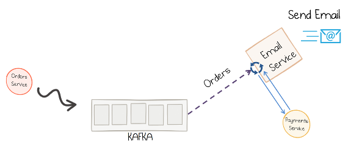
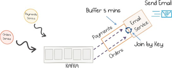
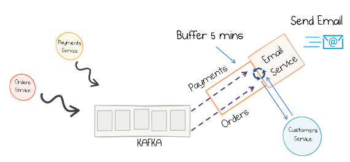
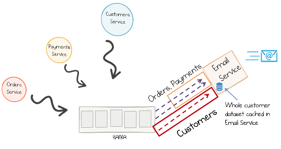
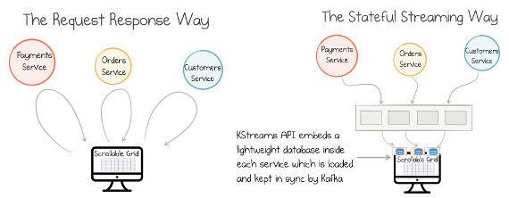

# 第六章 &emsp; 使用有状态函数处理事件

命令式编程风格是最古老的编程范式之一，其经久不衰自有其道理。在这种风格中，过程按顺序执行，如同在页面上讲述一个故事，并在执行过程中不断改变程序的状态。

20 世纪 80 年代和 90 年代，随着主流应用程序向分布式架构转型，人们将这种思维模式也应用到了分布式领域。诸如 CORBA 和 EJB（Enterprise JavaBeans）之类的技术提升了抽象层级，使得分布式编程变得更容易上手。然而，历史对这些技术的评价并不总是那么正面。EJB 在当时曾被吹捧为“万灵药”，但很快便被边缘化了——因为系统在“紧耦合”带来的沉重负担下不堪重负，且当时存在一种错误的观念，即认为网络细节应当对程序员完全屏蔽（即通过抽象将其隐藏起来）。

平心而论，情况此后已有所改善。如今，gRPC 和 Finagle 等主流技术在“请求驱动”的编程风格中引入了异步机制。但将这种思维模式应用于分布式系统设计，未必是最高效或最具韧性的选择。在分布式设计（尤其是服务化架构）中，数据流（dataflow）编程和函数式编程是更为合适的两种范式。

如果你曾使用过 Sed 或 Awk 等工具，想必对“数据流编程”并不陌生。这类工具主要用于文本处理：例如，将文本行流逐行传入正则表达式进行处理，并将输出通过管道（pipe）传递给下一个命令，从而利用标准输入（stdin）和标准输出（stdout）将多个操作串联起来。这种程序风格类似于流水线：产品在传送带上移动，而每个“工人”负责执行特定的任务。由于每个“工人”只关注输入数据的就绪状态，因此无需追踪任何“隐藏状态”。这与流处理系统（streaming systems）的工作方式非常相似。在流处理器中，事件不断累积，等待特定条件（例如两个不同数据流之间的“连接”/join 操作）的触发。一旦所需的事件齐备，连接操作便会完成，处理流水线随即进入下一个环节。因此，Kafka 在分布式架构中的作用类似于 Unix Shell 中的“管道”，而流处理器则充当了其中串联的各个函数。

函数式编程中也存在一个类似的、非常有用的类比。与数据流（dataflow）风格类似，状态不会在原地被修改，而是随着函数调用不断演变；这与流处理（stream processing）系统的运作方式高度契合。因此，函数式语言和数据流语言所具备的诸多优势，同样适用于流处理系统。这些优势大致可以概括为：

- 流处理天生具备并行化能力。
- 流处理非常适合构建缓存数据集并保持其同步更新。这使得它特别适用于数据与代码通过网络进行交互的系统，例如数据处理系统和图形用户界面（GUI）。
- 与传统方法相比，流处理系统更具韧性（resilience）；高可用性是其运行时环境的内置特性，且程序执行过程能够确保数据不丢失（详见第 7 章关于“事件溯源”/Event Sourcing 的讨论）。
- 流处理中的函数通常比常规程序更容易推理。纯函数（pure functions）没有副作用；有状态函数（stateful functions）虽然存在副作用，但避免了共享的可变状态（shared mutable state）。
- 流处理系统支持多语言环境，既可以集成不同的编程语言，也可以对接多种数据存储系统。
- 程序在更高的抽象层级上编写，因此更易于理解。

然而，流处理方法也带来了一些固有的弊端。纯函数式语言在与文件系统或网络等过程式（procedural）或有状态（stateful）的组件交互时，往往会面临“阻抗失配”（impedance mismatch）的问题。同样地，流处理系统在与 REST 或 RPC 等“请求-响应”式接口交互时，也经常需要进行相应的转换。为了解决这一问题，一些开发者采用了“函数式核心，命令式外壳”（functional core, imperative shell）的架构模式：系统核心以函数式方式异步处理事件，而外层则由命令式代码包裹，负责与外部的“请求-响应”接口进行数据转换与交互。这种模式既保证了系统核心的灵活性与可扩展性，又鼓励服务组件尽量避免副作用，并将业务逻辑表达为通过日志（log）串联起来的简单函数。

在下一节中，我们将深入探讨在流处理的语境下，为什么“有状态性”（statefulness）至关重要。

## 让服务具备“状态”

业界普遍推崇“无状态”架构，这不无道理。无状态服务能够瞬间启动（无需加载数据），并且可以像流水线生产的标准件一样，进行线性横向扩展。

Web 服务器就是一个典型的例子：若要提升其生成动态内容的能力，只需增加新的服务器，即可实现 Web 层的横向扩展。那么，我们还有什么理由去追求其他模式呢？问题的关键在于，大多数应用程序并非真正“无状态”。Web 服务器需要明确该渲染哪些页面、哪些会话处于活跃状态等信息。它通过将这些“状态”存储在数据库中来解决此类问题——即数据库是有状态的，而 Web 服务器是无状态的。本质上，状态管理的问题只是被下沉到了更底层。然而，随着网站流量的增长，程序员往往会倾向于在本地进行状态缓存；而本地缓存又引出了缓存失效（cache invalidation）策略，进而往往会引发一系列复杂的数据一致性问题。

流处理平台在处理“状态应存放在何处”这一问题时，采取了略有不同的思路。首先，请记住：事件本身即事实。它们如同装配线上的传送带一般，源源不断地汇聚至流处理器。因此，在许多应用场景中，触发流程的事件本身就包含了程序所需的一切数据——这与前文讨论的“数据流编程”模型如出一辙。例如，若要校验订单内容，只需获取该订单的事件流即可。

有时，这种“无状态”处理模式是自然形成的；而在另一些情况下，开发者会主动在事件进入处理流程前对其进行“丰富”（enrichment），以确保手头掌握了完成任务所需的所有数据。然而，这种数据丰富过程往往不可避免地涉及外部查询——通常就是查询数据库。

*有状态*的流处理引擎（例如 Kafka Streams API）则更进一步：它们确保计算所需的所有数据——无论是事件本身，还是用于查询或数据丰富所需的各类表（table）——都能提前加载到 API 中。在许多场景下，这意味着 API（进而整个应用程序）变得“有状态”了；一旦程序因故重启，必须先重新获取这些状态，才能继续执行后续任务。

这听起来或许有些反直觉。为什么要让服务具备“有状态”特性呢？从另一个角度来看，这可以被视为一种更高级的缓存形式，特别适合数据密集型工作负载。为了更清楚地说明这一点，我们来看三个示例：第一个示例涉及数据库查询；第二个示例基于事件驱动，但属于“无状态”；第三个示例同样基于事件驱动，但属于“有状态”。

### 事件驱动方法

假设我们有一个电子邮件服务，它监听订单事件流，并在用户完成购买后向其发送确认邮件。这需要获取订单以及相关支付的信息。此类电子邮件服务可以通过多种方式实现。我们先假设它是一个简单的事件驱动服务（即不使用流处理 API，如图 6-1 所示）。它可以响应订单事件，然后查询相应的支付信息；也可以反过来：响应支付事件，然后查询相应的订单信息。我们暂且假设采用前者。

*图 6-1。一个简单的事件驱动型服务，它在处理消息时查找所需数据*

在这种方案中，系统处理单一事件流，并通过“内联”（inline）方式执行查找操作，以获取所需数据。该方案存在两个问题：

- 需要频繁进行查找操作，且每处理一条消息就得执行一次。
- 支付和订单几乎同时生成，因此其中一个可能会比另一个先到达。这意味着，如果订单先于支付信息到达电子邮件服务（而此时支付信息尚未写入数据库），系统就不得不采取“阻塞并轮询”的方式等待数据就绪；更糟糕的情况是，系统甚至可能直接跳过该订单的邮件处理流程。

### 纯（无状态）流处理方法

流处理系统从一个略有不同的角度来处理这个问题。数据流会被缓存起来，直到两个事件全部到达，随后便可将它们连接（join）在一起（图 6-2）。

*图 6-2。在运行时连接两个流的无状态流处理服务*

这种方法解决了前述事件驱动模式中的两个问题。首先，它消除了远程查找的需求；其次，事件到达的顺序不再重要。

其中，第二个问题尤为关键。在使用异步通道时，很难确保多个通道之间事件的相对顺序。因此，即便我们明确“订单”事件一定先于“支付”事件生成，也可能因为延迟导致它们以相反的顺序到达。

最后需要指出的是，严格来说，这种方法并非完全“无状态”。缓冲区实际上使邮件服务具备了一定的状态。当 Kafka Streams 重启时，它会先重新加载各个缓冲区中的内容，然后再进行后续处理。这一点对于确保结果的确定性至关重要——例如，在执行连接（join）操作时，输出结果取决于消息到达时对应缓冲区中的内容。

### 有状态流处理方法

遗憾的是，在各类事件流中流动的数据往往并不足够——有时你需要进行查找或数据丰富。例如，电子邮件服务需要获取客户的电子邮箱地址，但事件流中未必会有相关的最新事件（除非你运气极好，恰好赶上客户更新了个人信息）。因此，你必须通过某种方式（例如发起 REST 调用）从客户服务系统中查询该电子邮箱地址（见图 6-3）。

*图 6-3。一个无状态流处理服务，在运行时查找另一个服务中的引用数据*

这当然是一种完全可行的方法（事实上，许多生产系统正是这样做的），但有状态流处理系统可以进行进一步的优化。它同样采用了本地缓冲机制——该机制本是为应对“订单”和“支付”主题中可能出现的延迟而设计的——但它并非仅进行几分钟的缓冲，而是将来自 Kafka 的完整客户事件流预加载到电子邮件服务中，从而能够基于这些数据查询历史记录（图 6-4）。

*图 6-4。一个有状态的流处理服务，它将 Customers 主题复制到 Kafka Streams API 内部的本地表中*

因此，现在的电子邮件服务既会缓存近期事件，也会构建一个本地查找表。（其具体实现机制将在第 14 章中详细讨论。）

这种最终的、完全有状态（stateful）的方法既有缺点：

- 该服务现在是有状态的，这意味着电子邮件服务的某个实例若要正常运行，必须具备相关的客户数据。在最坏的情况下，这意味着启动时需要加载完整的数据集。

也有优点：

- 该服务不再受客户服务（customer service）在最差性能表现或可用性状况下的制约。
- 该服务处理事件的速度更快，因为每项操作的执行都无需发起网络调用。
- 该服务可以更自由地对其所持有的数据执行更多以数据为中心（data-centric）的操作。

最后一点对于我们当今构建的、日益以数据为中心的系统尤为重要。举个例子，假设我们有一个图形用户界面（GUI），允许用户在可滚动的网格中浏览订单、支付和客户信息。用户可以通过上下滚动来查看网格中显示的内容。

在传统的无状态（stateless）模型中，屏幕上的每一行数据都需要分别向这三个服务发起调用。在实际应用中，这种方式会非常缓慢，因此通常会引入缓存，并辅以某种人工编写的轮询机制来保持缓存的实时更新。

而在流处理方案中，数据会持续不断地被推送到用户界面（见图 6-5）。你可以为网格中显示的数据定义一个查询，例如 `select * from orders, payments, customers where…`。API 会在传入的事件流上执行该查询，将结果存储在本地，并保持其持续更新。因此，流处理在某种程度上就像是一个以声明式方式定义的缓存。

*图 6-5。有状态流处理被用于在 Web 服务器内部物化数据，从而使 UI 能够进行本地访问以获得更好的性能；在本例中，这种访问是通过一个可滚动网格实现的。*

### 有状态处理的实际应用考量

采用有状态处理模式会带来一些挑战：当一个新节点启动时，它必须先加载所有的有状态组件（即状态存储），然后才能开始处理消息；在最坏的情况下，这一重新加载过程可能会耗费较长时间。为了缓解这一问题，Kafka Streams 提供了三种机制，使得有状态处理在实际应用中变得更加可行：

- 它采用了“备用副本”（standby replicas）技术，确保节点上的每个表或状态存储，在另一个节点上都有一个保持同步的副本。因此，一旦某个节点发生故障，系统可以立即故障转移（failover）至其备份节点，从而避免处理过程受到不必要的干扰。
- 系统会定期创建磁盘检查点（disk checkpoints）。这样，如果节点发生故障并重启，它便能加载之前的检查点，随后从日志中补齐其离线期间所错过的少量消息。
- 最后，通过使用“压缩主题”（compacted topics），可以将数据集保持在尽可能小的规模。当需要进行完整重建时，这有助于缩短加载所需的时间。

Kafka Streams 使用了中间主题（intermediary topics），这些主题可以通过 Streams 重置工具（Streams Reset tool）进行重置并重新推导生成。1

<table>
    <tr>
        <td>
            
        </td>
        <td>
            <i>事件驱动型应用程序（event-driven application）</i>使用单个输入流来驱动其工作。<i>流处理应用程序（streaming application）</i>则将一个或多个输入流合并，转换为一个或多个输出流。<i>有状态流处理应用程序（stateful streaming application）</i>还会将数据流转换为表（用于执行数据丰富操作），并将中间状态存储在日志中，从而在内部整合了其所需的所有数据。
        </td>
    </tr>
</table>

## 总结

本章介绍了三种不同的基于事件的处理方式：简单的事件驱动模式（即逐条处理单个事件流）、流处理模式（将多个不同的事件流连接起来），以及有状态流处理模式（将数据流转换为表，并将数据存储在日志中）。

因此，有状态流处理器（例如 Kafka 的 Streams API）无需将“状态”问题下沉至数据库层，而是能够直接在自身内部维护状态。它们确保数据在需要之处随时可用，从而提升了性能并增强了系统的自主性——完全无需远程调用！

当然，有状态处理也存在一些弊端，但它并非强制要求；在实际应用中，流处理系统往往会结合使用这三种方式。我们将在第 14 章详细探讨这些流处理操作的具体工作原理。

---

1 参见 *https://bit.ly/2GaCRZO* 和 *http://bit.ly/2IUPHJa* 。

