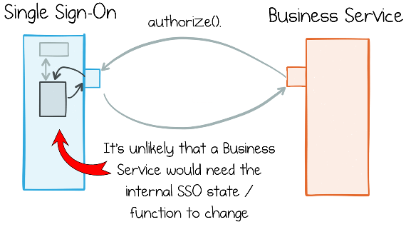
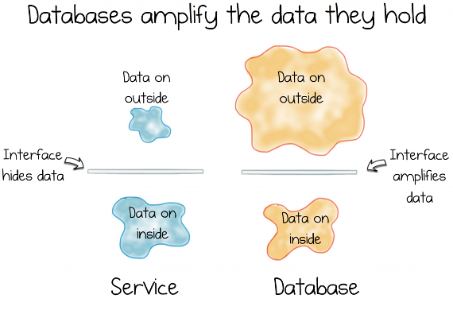
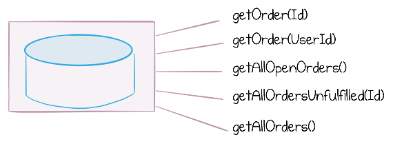
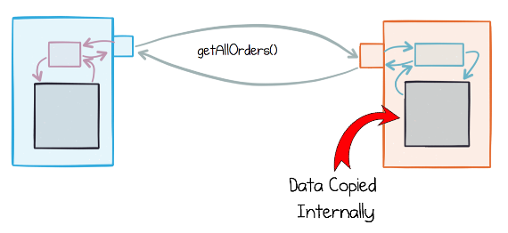
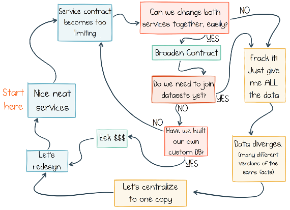
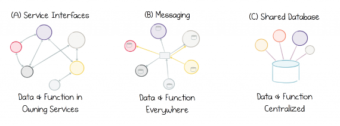

# 第八章 &emsp; 在组织内部共享数据和服务

在构建软件时，我们的核心关注点理所当然地在于解决现实世界中的问题。无论是开发新的网页、制作销售报表、编写用于识别欺诈行为的分析程序，还是提供各种能为用户带来切实益处的功能，这些目标都非常具体，且直接服务于我们当前的业务需求。

然而，在构建软件时，我们也会考虑到未来。这并非指试图通过“水晶球”去徒劳地预测公司明年的需求，而是基于一个事实：无论未来发生什么，我们的软件都必然需要随之演变。我们往往在不经意间就已在为此做准备：我们精心将代码模块化，以确保其易于理解且可复用；我们编写测试、实施持续集成，甚至进行持续部署。这些工作虽然需要投入大量精力，但从表面上看，它们与用户直接提出的需求似乎并无关联。我们之所以这样做，是为了让代码能够“长久存续”——这并非指让代码仅仅静静地躺在文件系统中（即 `git push` 之后的状态），而是指构建一个能够持续变更、演进、重构并适应新用途的代码库。软件的“老化”并非取决于时间的流逝，而是取决于*我们选择如何去改变它*。

但在设计系统时，我们却较少考虑它们会如何“老化”。我们往往更关注其他问题，例如：随着用户群的增长，系统能否实现扩展？响应速度是否足够快，以确保用户满意？系统设计是否利于代码复用？事实上，你或许会不禁思考：一个旨在长期存续的系统，究竟应该是什么样子的呢？

如果我们回顾历史来寻找这个问题的答案，可能会想到用于薪资管理的各类大型主机应用程序、像 Excel 或 Safari 这样广为人知的客户端软件，甚至是 Windows 或 Linux 这样的操作系统。这些软件虽然复杂且独立，却都为社会创造了巨大的价值。然而，它们在演进过程中也面临重重困难，尤其是在围绕单一代码库组织大规模工程协作时，挑战尤为突出。既然构建大型且独立的软件程序本身就已十分困难，那么我们该如何构建支撑整个公司运营的软件系统呢？这正是本部分要探讨的问题：我们该如何设计系统，使其在公司规模不断扩大的过程中依然能够稳健演进，并保持业务的敏捷性？

事实上，许多公司在初创阶段往往会明智地选择从单一系统起步；但随着时间推移，该系统会逐渐演变成一个庞大而混乱的“大泥球”（big ball of mud）。如今，应对这一问题的常见做法是将这种单体系统拆解为多个不同的应用程序和服务。在第 1 章中，我们曾提到亚马逊（Amazon）、LinkedIn 和 Netflix 等公司，它们采取的正是基于服务的架构模式。但这并非万能良药；事实上，许多微服务架构的实践都陷入了一个误区，即认为只要通过网络将软件模块化，就能提升其可持续性。当然，这并非微服务的真正内涵。无论你如何解读，仅仅拆解单体系统，对于提升可持续性而言，作用十分有限。这背后的原因很简单：当我们从公司规模的视角去设计系统时，这些系统所涉及的“人”的因素，远比“软件”本身更为关键。

随着公司规模的增长，组织会分化为不同的团队。各团队承担着不同的职责，且需要能够在无需频繁交互的前提下独立推进工作。公司规模越大，这种自主权的需求就越强烈。这正是诸如“松弛”（Slack）等管理理论的基础。1

与此截然不同的是，完全的独立也行不通。不同的团队或部门之间必须保持一定程度的交互，至少也应拥有共同的目标感。事实上，在政治和战争中，人为割裂社会群体往往被用作一种削弱对手能力的手段。这里的核心在于，企业必须在人员安排、职责划分以及沟通结构等方面实现某种平衡。这一点对于软件而言，其重要性丝毫不亚于对人员的管理；毕竟，一旦超越了单一应用程序的范畴，人为因素往往会起到决定性作用。

一些企业会从组织层面着手解决这一问题，例如采用“逆康威策略”（Inverse Conway Maneuver）。该方法基于这样一个理念：既然软件的形态与组织的形态之间存在内在联系（正如 Conway 所言），那么改变组织架构并让软件架构随之调整，往往比反向操作要容易得多。无论采取何种策略，当我们设计由独立运行且不断演进的组件所构成的软件系统时，我们所面临的问题实际上涵盖了三个相互关联的维度：组织、软件和数据。更复杂的是，优秀系统与糟糕系统之间的真正区别，在于前者能否在这些要素随时间各自演进的过程中，有效地对其进行管理。

虽然这听起来可能有些抽象，但你一定曾亲身感受到这些力量之间的相互作用。假设你正在负责一个项目，但必须等待其他三个团队先完成各自的工作，你凭直觉就能预料到，整个项目的构建、排期和发布周期将会被拉长。如果另一个团队提出想要从你的数据库中提取数据，你很清楚这日后可能会带来麻烦——因为你不得不担心，你的下一次版本发布是否会破坏他们所依赖的接口或数据结构。再比如，调用几个 REST 服务来填充用户界面看似简单，但一旦对方服务中断，你很可能在凌晨三点被叫醒去处理故障；而且，依赖关系越复杂，排查系统故障的原因就越困难。这些都是组织、软件和数据演进迟缓时所面临的典型问题。

在这一方面，“微服务”模式有着非常鲜明的立场：它极力强调组织、软件和数据层面的独立性。微服务由不同的团队负责，拥有各自独立的部署周期，且既不共享代码，也不共用数据库。2 然而，若以错综复杂的 RPC/REST 调用网络来取代这种架构，通常并非理想之选。这引出了一个关键矛盾：我们既希望通过促进复用来加速软件开发，但与此同时，依赖关系越多，系统变更的难度也就越大。

<table>
    <tr>
        <td>
            
        </td>
        <td>
            “复用”有时并非好事。虽然复用能让我们快速、简洁地开发软件，但一个组件被复用的次数越多，它所承载的依赖关系也就越多，进而变得越难修改。
        </td>
    </tr>
</table>

为了更好地理解这种矛盾，我们需要审视软件设计中的一些核心原则——这些原则在构建单一应用程序时非常有效，但在构建涉及多个团队的软件系统时，却往往不再那么适用。

## 封装并非总是你的良伴

作为软件工程师，我们被教导要进行封装。如果你正在构建一个供他人使用的程序库，你会精心设计一套接口契约，以适配你想要对外暴露的功能。如果你正在构建一个基于服务的系统，你或许也会倾向于遵循类似的流程。如果能够清晰地界定不同服务之间的职责，这种做法效果会很好。例如，单点登录（SSO）服务就拥有明确的角色定义，且与其他服务所承担的角色界限分明（图 8-1）。这种清晰的职责划分意味着，即便需求频繁变更，SSO 服务也极少需要随之调整。它存在于一个边界清晰的限界上下文（bounded context）之中。

*图 8-1。单点登录 (SSO) 服务是封装和重用的一个很好的例子*

问题在于，在现实世界中，业务服务往往无法保持界限分明（即“关注点分离”）；这意味着新的需求不可避免地会跨越服务边界，导致多个服务需要同时进行变更。这种情况是可以量化的。3 因此，如果一个团队需要实现某项功能，而这又要求另一个团队修改代码，那么最终结果就是两个服务都需要在相近的时间点进行变更。在单体系统中，这相对简单——只需完成修改并发布即可；但在独立服务需要同步协作的环境下，这一过程则要麻烦得多。团队之间的协调以及发布周期的同步，会削弱系统的敏捷性。

这个问题实际上并非仅限于“服务”，共享库（shared libraries）也存在同样的问题。以零售行业为例，你可能会觉得创建一个库来建模客户、订单、支付等实体之间的关系是个好主意，甚至可以将退货、退款等标准操作的通用逻辑也包含在内。在面向对象编程的早期阶段，许多人都曾尝试这样做，但结果却非常棘手：系统中最核心、最敏感的部分被耦合到了多个不同的程序中，导致后续的修改和发布变得异常繁琐。这正是微服务架构通常不共享单一领域模型（domain model）的原因。当然，在某些情况下，复用库是完全没问题的。例如日志库——就像前面提到的单点登录（SSO）示例一样——你几乎不会遇到那种需要修改日志库本身的业务需求。

然而在现实中，库的复用其实留有一个“退路”：代码完全可以在其他地方重新实现。假设你确实使用了前述的共享零售领域模型，如果发现它用起来太痛苦，你完全可以自己重写一份！（至于这样做是否明智，那是另一个话题了。）但当我们面对那些需要共享数据的不同应用程序或服务时，却不存在这种“退路”：*如果你没有数据，那就真的什么也做不了*。

这引出了服务与共享库之间的两个根本区别：

- 服务是由他人运行和维护的。
- 服务通常拥有自身的数据，而库（或数据库）则需要你主动输入它所需要的数据。

数据正是这一问题的核心所在：大多数业务服务在很大程度上不可避免地依赖彼此的数据。如果你是一家在线零售商，那么订单流、产品目录或客户信息，往往会成为你旗下多项服务所必需的数据。这些服务在执行各自任务时，都需要广泛地访问这些数据集；而一旦缺少所需数据，又没有临时的变通方案可以解决。因此，你既需要访问共享数据集，又希望保持系统间的松耦合——要在两者之间取得平衡，绝非易事。

## 数据二分法

封装提倡隐藏数据，但数据系统与封装却几乎毫无关联。事实上，情况恰恰相反：数据库会竭尽所能地将其所持有的数据暴露出来（图 8-2）。它们提供了功能极其强大的声明式接口，能够将所存储的数据转换为你想要的几乎任何形态。对于数据科学家开展探索性分析而言，这确实非常理想；但对于管理日益庞大的服务体系中那错综复杂的跨服务依赖关系来说，这却未必是件好事。

*图 8-2。服务封装其所持有的数据，以降低耦合度并促进数据重用；数据库则放大其所持有的数据，从而为用户提供更大的效用*

因此，我们面临着一个难题，一种二元对立：数据库旨在呈现数据并发挥其价值，而服务则旨在隐藏数据，以保持彼此间的解耦。这两种力量是根本性的；它们构成了我们各项工作的基础，并在我们构建的系统中，以微妙的方式相互角力，争夺着主导地位。

## 系统在演进过程中会发生什么？

随着系统的演进与增长，这种数据二分法所带来的影响会以几种不同的方式显现出来。

### “上帝服务”（God Service）问题

随着数据服务不断增长，它们不可避免地会对外暴露越来越多的功能，以至于最终看起来就像某种古怪的、自研的数据库（图 8-3）。

*图 8-3。服务接口不可避免地会随着时间推移而增长*

构建出一种类似于“古怪的共享数据库”的东西，可能会引发一系列特有的问题。数据服务所承载的功能、数据和用户越多，它们之间的耦合度就越高，其运维与演进的难度（以及成本）也就随之增加。

### REST 转 ETL 问题

在面对数据服务时，还会出现另一种更为常见的情况：将数据提取出来，以便在本地进行存储和处理，往往反而成了更好的选择（图 8-4）。在实际应用中，导致这种情况的原因有很多，其中主要包括：

- 需要将该数据与其他数据集进行整合。
- 出于地理位置因素，或者为了支持离线使用（例如在移动设备上），需要让数据在物理上更接近使用者。
- 数据服务本身存在运行问题，导致下游服务中断。
- 数据服务无法提供客户端所需的功能，或者无法足够迅速地进行变更。

然而，若要从某项服务中提取数据并保持其同步更新，就需要引入某种轮询机制。虽然这并非完全不可接受，但也绝非理想方案。

*图 8-4。数据以批量方式在服务之间传输*

此外，在大型架构中，随着数据不断被提取并在各项服务之间迁移，这种过程反复发生，往往会引入细微的错误或偏差。久而久之，这些问题会不断加剧，导致整个生态系统的数据质量受损。可变副本越多，数据随时间推移而产生分歧（即不一致）的情况就越严重。

更糟糕的是，一旦数据集出现分歧，事后再去修复将变得非常困难。（诸如“主数据管理”之类的技术手段，在很大程度上也只是治标不治本的“权宜之计”。）事实上，企业所面临的一些最棘手的技术难题，往往就源于数据集在不同应用程序之间扩散并产生分歧。第 10 章将对这一问题进行更详细的探讨。

因此，在以下两种倾向之间形成了一种循环模式：(a) 为了确保数据准确性而推动数据集的集中化；(b) 出于某种诱因（或实际需求）而将数据集提取出来、进行独立管理。这便陷入了一个“数据不足”的无尽循环（见图 8-5）。

*图 8-5。数据不足的循环*

## 让“外部数据”成为架构中的“一等公民”

为了解决这些问题，我们需要以一种全新的视角来看待共享数据——将其视为我们所构建架构中的“一等公民”。Pat Helland 在其论文《内部数据与外部数据》（Data on the Inside and Data on the Outside）中明确提出了这一区分。

他提出的一个核心观点是：服务所共享的数据，与服务内部持有的数据，应当区别对待。“外部数据”往往难以变更，因为许多程序都依赖于它；但也正因如此，它才显得尤为重要。

另一个重要观点是，服务团队应当采取一种“面向外部”的姿态：即致力于服务整个生态系统，并成为其中的有机组成部分。这与传统应用程序的构建方式截然不同——传统应用往往被设计为独立运行，而数据暴露机制通常只是在后期作为一种“补丁”附加进去的。

基于上述认识，显而易见，“外部数据”（即服务所共享的数据）需要经过精心的治理与培育。同时，为了保持迭代的灵活性，我们需要将其转化为“内部数据”，从而将其纳入自身的掌控之中。

然而，目前现有的各种方案——无论是服务接口、消息传递，还是共享数据库——都无法妥善解决这一转化过程中的难题（见图 8-6），原因如下：

- 服务接口会形成紧密的点对点耦合，难以实现大规模的数据共享；此外，它还留下了一个悬而未决的问题：如何将那些彼此孤立的状态片段重新整合在一起？
- 共享数据库将各类用例集中于一处，这反而阻碍了系统的演进与发展。
- 消息传递机制能够将数据从紧密耦合的环境（源服务）转移到松散耦合的环境（使用该数据的一方）。这意味着不同的数据集可以被汇聚、丰富并按需处理。将数据迁移至本地，不仅通常能提升性能，还能实现发送方与接收方之间的解耦。遗憾的是，消息系统不提供历史参考信息，这意味着为新应用初始化数据变得更加困难；长此以往，还可能引发数据质量问题（详见第 10 章第 95 页的“数据分歧问题”一节）。

*图 8-6。服务接口、消息传递和共享数据库之间的权衡*

一种更好的解决方案是使用像 Kafka 这样支持重放的日志系统。它类似于一种“事件存储”：既具备消息系统的特性，又兼具数据库的功能。

<table>
    <tr>
        <td>
            
        </td>
        <td>
            消息传递机制能够将高度耦合、共享的数据集（即“外部数据”）转化为服务自身可以拥有并掌控的数据（即“内部数据”）。而支持重放的日志系统则更进一步，引入了一个中心化的参考基准。
        </td>
    </tr>
</table>

## 不要害怕演进

当你启动一个新项目、组建一个新部门或创办一家新公司时，并不需要从一开始就做到尽善尽美。大多数项目都是在演进中发展的。它们最初可能是一个庞大的整体（单体），随后逐渐引入分布式组件，演变为微服务架构，并加入事件流处理。关键在于，当现有的架构方式开始成为制约因素时，就应当做出调整。经验丰富的架构师深知这种“临界点”所在——如果调整得太晚，变更的成本可能会高到难以承受。这一点与“演进式架构”（Evolutionary Architectures）中的“适应度函数”（fitness functions）概念密切相关。4

## 总结

像微服务这类架构模式，对“服务独立性”有着明确的界定：服务由不同的团队负责，拥有各自独立的部署周期，且互不共享代码或数据库。然而，如果仅仅用错综复杂的 RPC（远程过程调用）网络来替代这种独立性，却无法解决一个核心问题：当服务需要进行超出简单查询之外的操作时，该如何访问这些分散在各个“数据孤岛”中的信息？

这种“数据二分法”凸显了上述矛盾：一方面，服务需要保持解耦；另一方面，服务又需要根据自身节奏去掌控、丰富并整合数据。

由此得出三个核心结论：（1）随着架构的扩展和系统日益以数据为中心，在不同服务之间迁移数据集，已成为系统演进过程中不可避免的一环；（2）“外部数据”（即服务间共享的数据）本身已成为一个重要的独立实体；（3）共享数据库并非处理“外部数据”的明智之举；相比之下，共享“可重放日志”（replayable log）能更好地平衡这些需求——它既能长期存储数据集，又能支持事件驱动编程，从而实现对当前状态的实时响应。

通过这种方式，多个服务之间的数据可以保持同步，且各服务仍能通过松耦合的接口，自由地在本地对数据进行切分、重组、丰富和演进。

---

1 Tom DeMarco，《Slack：克服倦怠、无效忙碌与“绝对效率”的迷思》（纽约：Broadway Books，2001年）。

2 Sam Newman，《构建微服务》（加利福尼亚州塞瓦斯托波尔：O’Reilly，2014年）。

3 参见 *https://www.infoq.com/news/2017/04/tornhill-prioritise-tech-debt* 及 *http://bit.ly/2pKa2rR* 。

4 Neil Ford、Rebecca Parsons 和 Pat Kua，《构建演进式架构》（加利福尼亚州塞瓦斯托波尔：O’Reilly，2017年）。

