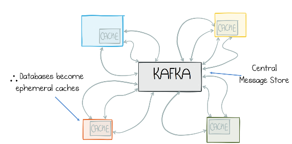
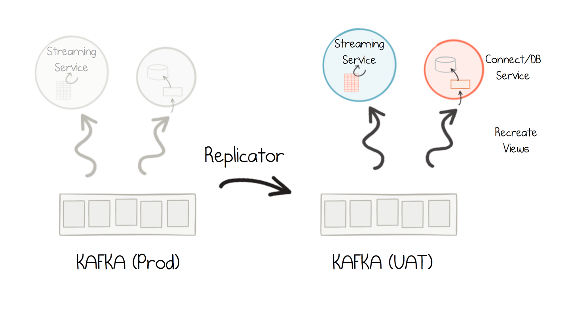

# 第十章 &emsp; 瘦数据

“瘦数据”（Lean data）这一理念十分简单：应用程序无需收集和维护庞大的数据集，而是精心挑选规模较小、精简的数据集——即在特定时间点实际所需的数据——并将其从中央事件存储库推送至缓存或由应用程序自身管控的存储空间中。这些轻量级视图的背后，依托着一系列能够确保在必要时重新推导出这些视图的运维流程。

## 如果消息系统能够“记住”一切，数据库便无需承担此责

将事件流（event stream）作为“事实来源”（source of truth，参见第 9 章）会带来一个有趣的后果：从日志中提取出的数据无需进行可靠存储。即便数据丢失，也总能从日志中重新获取。因此，如果消息层能够“记住”所有信息，那么下游的数据库就不必再承担这一职责（见图 10-1）。这意味着，如有必要，你可以完全根据日志重新生成数据库或基于事件溯源（event sourcing）构建的视图。这听起来或许有些奇怪——为什么要这么做呢？

在传统的“消息传递”或 ETL（提取、转换、加载）流水线等场景中，消息层通常是瞬态的；一旦消息被读取，用户往往会将其写入数据库——毕竟，这些消息可能再也不会被访问了。这种做法会引发一些问题：系统架构变得相当臃肿，大量的应用程序和服务各自保存着公司数据副本，且这些副本往往占据了数据总量的很大一部分。从宏观角度来看，随着时间推移，这些副本之间会逐渐产生差异，进而导致数据质量问题。

数据质量问题非常普遍，且往往比人们预想的更为严重。其成因多种多样。其中一个原因在于，我们将数据库视为一种“长期存在”的资源，在漫长的生命周期中不断对其进行调整和优化，这往往会无意中引入错误。从本质上讲，数据库就是一个文件，其“年龄”与它所处的系统一样久远。它会在不同环境之间被反复复制，且在整个生命周期内，其中的数据也经历过多次运维层面的修复。因此，出现错误和偏差也就不足为奇了。

在流处理（stream processing）中，文件不会以这种方式被到处复制。如果流处理器创建了一个视图，随后在发布新版本时改变了该视图的结构，通常的做法是直接丢弃旧视图，将偏移量（offset）重置为 0，并根据日志重新推导出一个全新的视图。

放眼行业内的其他领域——例如 DevOps 及其相关实践——我们也能观察到类似的模式。曾几何时，系统管理员会逐一调整、优化并修改他们所管理的计算机。久而久之，这些计算机之间便会产生细微的差异；一旦出现问题，往往很难找出根源所在。

如今，在推崇“即服务”（as-a-service）理念的环境中，通过“基础设施即代码”（Infrastructure as Code）来实现“不可变性”（immutability），已在很大程度上解决了这类问题。这种方法带来了显著的优势：部署变得可预测（确定性），构建结果保持一致，且重新构建也变得轻而易举。运维工程师们因此能够从容应对——他们所掌控的基础设施具有高度的可预测性，且软件在生产环境中的表现能与测试环境完全一致，这让他们倍感安心。

在数据处理领域，流处理（streaming）也倡导类似的理念。基于事件溯源（Event Sourcing）构建的数据视图通常非常精简，且能够以确定性的方式从日志中重新推导出来。这些视图可以是缓存、Kafka Streams 的状态存储，甚至是功能完备的数据库。然而，要实现这一点，我们必须解决一个难题：数据加载过程往往非常缓慢。在下一节中，我们将探讨如何将这一问题控制在可管理的范围内。

*图 10-1。如果消息系统可以存储数据，那么它所供给的视图或数据库就不必再存储数据*

## 只获取所需数据，不多取分毫

如果数据集存储在 Kafka 中，那么在将数据拉取到服务中时，你可以只挑选自己需要的部分。这不仅能最大限度地减小最终视图的规模，还能对其进行重塑，使其更适合读取操作。这类似于关系数据库中使用“物化视图”（materialized views）来优化读取性能的做法；不同之处在于，在 Kafka 中，写入和读取是解耦的。（参见第 7 章第 62 页的“物化视图”一节。）

第 15 章中讨论的“库存服务”就是一个很好的例子。该服务会读取包含仓库中各类产品详细信息的库存消息。在处理每条消息时，它会舍弃掉文档中的绝大部分内容，仅保留两个字段：产品 ID 和库存数量。

通过缩减视图的广度，可以保持数据集的精简，并实现松耦合。数据集越小，在有限的内存或磁盘空间内就能存储更多的记录，性能通常也会随之提升。此外，这种方式还降低了耦合度——即便数据模式（schema）发生变更，由于服务并未存储那些受影响的字段，因此受到的波及也较小。

<table>
    <tr>
        <td>
            
        </td>
        <td>
            如果消息系统具备“记忆”功能（即保留了历史数据），那么派生视图就可以进一步精简，仅包含绝对必要的数据。如果后续需要更多信息，随时可以回溯获取。
        </td>
    </tr>
</table>

这种方法实现起来非常简单，既可以通过 Kafka Streams DSL 或 KSQL 来完成，也可以利用 Connect API 中的“单条消息转换”（Single Message Transforms）功能来实现。

## 重建基于事件溯源（Event-Sourcing）的视图

这种“瘦数据”方案的一个明显弊端是：一旦你需要更多数据，就必须回溯到原始日志中。最干净利落的做法是直接丢弃现有视图，然后从头开始重新构建。如果你使用的是内存数据结构，这一过程通常是自动完成的；但如果使用的是 Kafka Streams 或数据库，则需要考虑其他一些因素。

### Kafka Streams

如果使用 Kafka Streams 构建基于事件溯源（event-sourced）的视图，那么视图的重新生成就是常态。这些视图要么是“表”（即 Kafka 主题的直接物化形式），要么是“状态存储”（由声明式转换的结果填充，这些转换通过 JVM 代码或 KSQL 定义）。如果服务所在的磁盘丢失（或被移除），或者运行了 Streams Reset 工具，这些视图都会被自动重建。1 我们在第 6 章第 52 页的“有状态处理的实际应用考量”（The Practicalities of Being Stateful）一节中，更详细地探讨了 Kafka Streams 如何管理状态。

### 数据库与缓存

当今世界存在多种类型的数据库，它们在性能权衡方面各有侧重。虽然从零开始重建一个 50 TB 的 Oracle 数据库通常不切实际，但对于业务服务中使用的基于事件溯源的视图，只要技术选型得当，重新生成往往是完全可行的。

由于“最坏情况下的重建耗时”是关键制约因素，因此选择针对写入操作进行优化的数据库或缓存会大有裨益。可选项非常多，其中一些合理的选择包括：

- 内存数据库/缓存，例如 Redis、MemSQL 或 Hazelcast；
- 内存优化型数据库（如 Couchbase），或者允许禁用日志记录（journaling）功能的数据库（如 MongoDB）；
- 针对写入/磁盘进行优化、采用日志结构（log-structured）的数据库，例如 Cassandra 或 RocksDB。

### 应对数据移动的实际困难

重建基于事件溯源的视图可能是一个相当漫长的过程（耗时可能长达数分钟甚至数小时！2）。正因如此，在发布新版软件时，开发人员通常会提前（或并行）重建视图；待新视图的数据完全追上进度后，再完成从旧视图到新视图的切换。这与使用 Kafka Streams 的*有状态*流处理应用所采用的模式本质上是一致的。

这种模式非常适合那些仅需处理中小型数据集的简单服务（例如用于驱动规则引擎的服务）。如果数据集规模较大，加载时间自然会更长。如果需要在某个高度索引化且数据存储于磁盘的数据库实例中重建 TB 级的数据集，那么这种加载耗时可能会长到令人无法接受。但在许多常见场景下，那些具备快速写入能力或支持横向扩展的内存型解决方案，能够确保数据摄入始终保持高速。

## 自动化与模式迁移

如果工具不常被使用，运维人员往往会对其失去信任。当这些脚本直接作用于数据时，情况尤为如此（数据库回滚脚本就以“不可靠”而著称）。因此，在开发工作流中，当需要在不同环境间进行迁移时，最好的做法通常是直接根据日志重新构建视图，而不是像传统数据库工作流那样，在各个环境之间直接复制数据库文件（图 10-2）。

*图 10-2。数据被复制到 UAT 环境，并在其中从源重新生成视图*

一个很好的例子是模式（schema）发生变更的情况。如果你曾使用传统的消息传递方式将数据从一个系统集成到另一个系统，那么你可能遇到过消息模式发生“不向后兼容”变更的情形。例如，当你正将客户信息从消息系统导入数据库时，如果客户消息的模式发生了破坏性的变更，你通常需要编写数据库脚本来完成数据迁移，然后再去订阅新的消息主题。

如果使用 Kafka 来完整存储数据集，3 那么在模式发生变更时，你无需执行模式迁移，只需删除并重新生成视图即可。

## 数据分歧问题

在实践中，所有大型企业在发展过程中都会遇到数据质量问题。这实际上是一个极其深奥且复杂的话题，由此引发的问题往往难以解决，既费时费力，又代价高昂。

这些问题的根源多种多样。以一个典型的业务应用程序为例：它从其他多个系统加载数据，并将其存储在数据库中。在此过程中，涉及多种数据模型：用于数据传输的模型（如 JSON）、内部领域模型（如对象模型）、数据库中的数据模型（如 DDL），以及用于外部通信的各种模式（schema）。每种模型之间的转换都需要编写相应的代码，且随着模式的变更，这些代码也必须随之演进。这些层级以及对每一层级的理解差异，极易导致误解。

语义层面的问题则更为棘手，通常出现在团队、部门或公司之间的交汇处。以两家公司的合并为例：双方可能拥有大量本质相同但建模方式迥异的数据集。你或许会认为这只是简单的格式转换问题，但实际上往往存在更深层的语义冲突：供应商是否等同于客户？承包商是否属于员工？这些差异进一步增加了产生误解的风险。

因此，当数据在不同的应用程序或服务之间流转时，这种交互过程就像是在玩“传话游戏”（即信息在传递过程中不断失真）：起初一切正常，但随着时间推移，原始信息被曲解，最终演变成完全不同的内容。

由此引发的问题有时会非常严重：例如，银行的风险部门与财务部门对银行头寸的认定不一致；又如，某零售商因工作流程过于冗长，竟需耗时一周才能回答客户的咨询。几乎所有大型企业都曾经历过此类问题。因此，虽然在构建小型 Web 应用程序时通常不会遇到这类挑战，但对于许多规模更大、架构更成熟的系统而言，这却是一个必须面对的问题。

针对这些挑战，业界已有行之有效的应对方法。一些公司会建立专门的数据核对系统，甚至围绕这些系统形成了自成一体的“小作坊式产业”。事实上，有一个专门的行业致力于解决这一问题，即“主数据管理”（Master Data Management）；此外，还有一系列工具可用于处理和规整数据，使其趋于统一。

流处理平台则以一种略有不同的方式来应对这些挑战。首先，它们构建起一种“中枢神经系统”，将所有应用程序连接至单一的“事实来源”（source of truth），从而避免了信息在传递过程中因失真而产生的偏差（类似于“传话游戏”中的效应）。其次，由于数据以不可变（immutable）的形式保存在日志中，一旦出现错误，不仅更容易追溯其源头，而且在掌握原始数据的情况下，修复问题也变得更加容易。因此，尽管人类难免会犯错或产生误解，但通过采用“事件流作为事实来源”、“命令溯源”（Command Sourcing）以及“瘦数据”（lean data）等技术手段，各团队能够建立起必要的运营成熟度——既能在源头上预防错误的发生，也能在错误发生后及时修复其带来的影响。

## 总结

在处理数据时，我们应当明确系统中的“共享事实”。毕竟，这些事实正是我们业务的核心所在。瘦数据实践倡导我们紧扣这些共享事实，并据此构建出针对特定问题域进行优化的“视图”。这种做法既保持了视图的轻量化，又使其更易于重新生成；其背后的思维方式，与我们在第 7 章中探讨的“命令溯源”（Command Sourcing）和“事件溯源”（Event Sourcing）如出一辙。因此，尽管这些事实可能会随时间演变、以不同方式被应用，或在不同上下文中进行重构，但它们始终都归于同一个“单一事实来源”（single source of truth）。

---

1 参见 *http://bit.ly/2GaCRZO* 和 *http://bit.ly/2IUPHJa* 。

2 作为参考基准，RocksDB（Kafka Streams 所使用的存储引擎）每分钟可批量加载约 1000 万个 500 KB 的对象（大致相当于千兆以太网的传输速度）。Badger 在每块 SSD 上每分钟可处理约 400 万个 1 KB 的对象。Postgres 每分钟可批量加载约 100 万行数据。

3 我们假设数据集已经通过某种技术（例如“双模式升级窗口”——详见第 13 章第 124 页的“处理模式变更与破坏向后兼容性”一节）完成了迁移。

