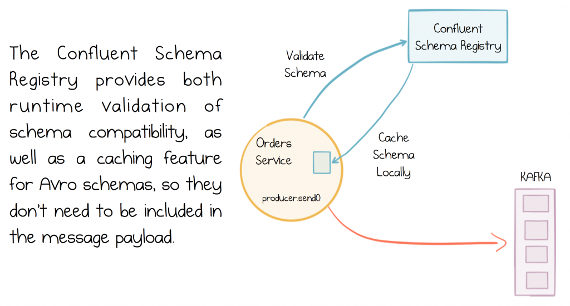
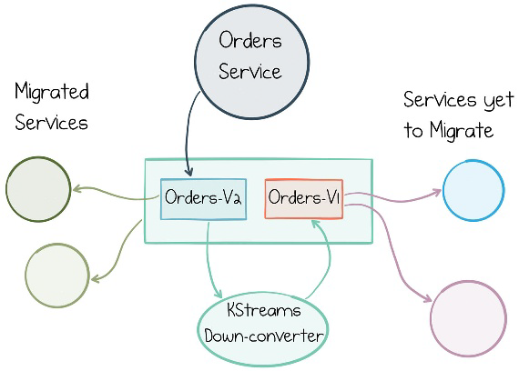

# 第十三章 &emsp; 随时间演变的模式和数据

模式（schema）是事件驱动型服务所使用的 API；因此，发布者和订阅者必须就消息的具体格式达成一致。这种共识在发送方和接收方之间建立了一种基于共享模式的逻辑耦合。正如请求驱动型服务利用“服务发现”技术来定位 API 一样，事件驱动型系统也需要某种机制来发现可用的主题（Topic）以及这些主题所提供的数据（即模式）。

在模式管理方面，有多种方案可供选择：Protobuf 和 JSON Schema 都很常用，但在 Kafka 生态中，大多数项目倾向于使用 Avro。为了实现集中式的模式管理与验证，Confluent 提供了一个开源的 Schema Registry（模式注册中心），作为 Avro 模式的统一存储库。

## 利用模式管理数据随时间的演进

模式相当于一份契约，定义了消息应有的结构。这一点非常直观。更重要的是，大多数模式技术都提供了一种验证机制，能够判断采用新模式的消息是否与旧版本保持“向后兼容”（反之亦然）。这一特性至关重要。（在独立演进的服务之间，切勿使用 Java 序列化或任何不支持演进的数据格式。）

假设你在订单（Order）的模式中新增了一个“返回码”（return code）字段；这属于向后兼容的变更。使用旧版模式运行的程序依然能够读取消息，只是它们无法感知到这个新增的“返回码”字段（这被称为“向前兼容”）；而使用新版模式的程序则能够读取完整消息，包括该“返回码”字段（这被称为“向后兼容”）。

遗憾的是，无法以兼容的方式移动或删除模式中的字段（尽管通常可以通过“克隆”字段来模拟移动）。在这种情况下，数据会在两处同时存在，直到能够发布一次“破坏性变更”（breaking change）为止。

通过这种“只增不减”的演进方式，既能更新模式，又不会破坏旧程序——这正是大多数共享消息模型在长期演进中所采用的管理模式。

Confluent Schema Registry 正是用于管控和执行这一机制的工具。Schema Registry 提供了 Kafka 主题与其所用模式（Schema）之间的映射关系（图 13-1）。它还在消息被写入之前强制执行兼容性规则。因此，Schema Registry 会检查发送至 Kafka 的每一条消息，以验证其是否符合 Avro 兼容性要求，从而确保不兼容的消息无法成功发布。

*图 13-1。在订单服务中读取和写入订单时，调用 Schema Registry 来验证模式兼容性*

### 处理模式变更与破坏向后兼容性

在关系型数据库时代，漫长的模式（Schema）迁移过程常为人所诟病。然而，模式演进实际上是数据生命周期中的一个基本特征。与过去相比，如今“延迟绑定”（late-bound）或“读取时解析模式”（schema-on-read）的方法，允许在同一张表、同一个主题（Topic）或其他类似的数据结构中，同时存在多种不兼容的数据模式。这种方式将格式转换（从旧格式到新格式）的问题转移到了应用层，因此被称为“读取时解析模式”。

“读取时解析模式”在多种场景下都非常有用。在许多情况下，近期数据往往比旧数据更具价值；因此，程序无需迁移那些不再被关注的旧数据，即可继续运行。这是一种在实践中被广泛采用的实用解决方案，尤其是在消息传递系统中。此外，如果代码库中已经包含了针对旧模式的解析逻辑（实际情况中往往如此），那么实现“读取时解析模式”也会变得相当简单。

然而，无论采取哪种方案，除非进行一次彻底的“一次性全量发布”（big-bang release），否则你终究还是需要面对模式演进的问题——无论是通过物理迁移数据集，还是在应用层编写不同的处理逻辑。Kafka 也不例外。

正如我们在上一节中所讨论的，在大多数情况下，通过“增量式”变更（即仅添加新字段，而不进行字段移动或删除），可以保持模式的向后兼容性。但有时，模式确实需要进行非向后兼容的升级。最常见的做法是采用“双模式（dual-schema）升级窗口”（Dual Schema Upgrade Window）：即创建两个主题（例如 orders-v1 和 orders-v2），分别用于存放采用旧模式和新模式的消息。假设订单数据由“订单服务”（orders service）负责管理，那么你可以选择以下几种方案：

- 订单服务可以同时向两个主题发布数据（分别对应两种模式），并利用 Kafka 的事务 API（Transactions API）确保发布操作的原子性。（注意：此方法无法解决历史数据的回填问题，因此不适用于作为长期存储的主题。）
- 订单服务可以将写入目标切换至 orders-v2 主题。引入一个 Kafka Streams 作业，将数据从 orders-v2 主题“向下转换”（down-convert）为 orders-v1 格式，以实现向后兼容。（注意：这种方法无法解决历史数据回填问题。）参见图 13-2。
- 订单服务（orders service）继续向 orders-v1 主题写入数据。同时引入一个 Kafka Streams 作业，将数据从 orders-v1 主题“向上转换”（up-convert）为 orders-v2 主题。待所有客户端完成升级后，将订单服务的写入目标切换至 orders-v2。（这种方法可以处理历史数据回填。）
- 订单服务可以在其内部数据库中完成数据集的迁移，然后将整个视图重新发布到 orders-v2 主题的日志中。此后，订单服务继续以相应的格式同时向 orders-v1 和 orders-v2 主题写入数据。（这种方法可以处理历史数据回填。）

上述四种方案的目标一致：为各服务提供一个可供升级的时间窗口。后两种方案在将历史消息从 v1 主题迁移至 v2 主题时更为便捷——如果 Kafka Streams 作业从偏移量（offset）0 开始运行，它便能自动完成这一迁移过程。因此，这种方式更适合那些数据保留期较长的主题，例如在“事件溯源”（Event Sourcing）场景中所使用的主题。

*图 13-2。双模式升级窗口：相同的数据共存于两个主题中，但模式不同，因此存在一个服务可以升级的窗口期*

在完全迁移至 v2 主题（topic）之前，各项服务将继续以这种“双主题”模式运行；迁移完成后，即可根据实际情况对 v1 主题进行归档或删除。

顺便提一下，我们在第 11 章中讨论过“单一写入者”（single writer）原则。采用这种方法的原因之一是，它能简化模式（schema）升级的过程。如果由三个不同的服务负责写入订单数据，那么在不进行联合发布（conjoined release）的情况下，想要安排一次非向后兼容的升级，难度会大得多。

## 关于模式变更的协作

在上一节中，我们讨论了如何发布不向后兼容的模式（schema）变更。然而，在执行此类变更之前——甚至在对模式进行微小调整之前——团队之间通常需要进行某种形式的协作，以评估该变更是否合理。这种协作方式多种多样。例如，向受影响的团队发送电子邮件，告知他们新的模式内容及上线时间，这相当常见；另一种方式是由一个专门的中心团队来统一管理这一流程。不过，在实际操作中，这两种方法的效果都不尽如人意：邮件沟通缺乏结构性和责任归属；而由中心团队统一管理则会拖慢进度，因为你必须等待该团队完成变更，并协调后续的审批确认环节。

在我所见过的方案中，利用 GitHub 进行协作是效果最好的。原因在于：(a) 模式本质上就是代码，因此应当像管理代码一样对其进行版本控制；(b) GitHub 允许变更实施者提出修改建议并提交“拉取请求”（Pull Request，简称 PR），团队成员可以在构建和测试系统的过程中，基于该 PR 进行开发。其他相关方则可以参与评审、发表评论并进行审批。一旦达成共识，即可合并 PR，进而发布新的模式。正是因为这一流程既能可靠地达成（并审计）变更共识，又不会对实施者的工作进度造成不必要的阻碍，才使得这种方法成为最实用的选择。

## 处理无法读取的消息

仅靠模式（Schema）并不足以确保下游应用程序能够正常运行。诸如语义错误（例如出现意外字符、无效的国家代码、负数数量值）甚至无效字节（例如因数据损坏导致）之类的问题，都可能导致处理流程停滞。这类错误通常会阻塞后续处理，直到问题得到解决；而在某些应用场景中，这种停滞是无法接受的。

传统消息系统通常包含一个相关概念，即*死信队列（Dead Letter Queue）*，1 用于存放那些无法发送的消息（例如因无法路由至目标队列而导致发送失败的消息）。虽然 Kafka 中并没有完全对应“死信队列”的机制，但消费者确实可能因语义问题或消息载荷无效（例如，读取时因消息损坏导致 CRC 校验失败）而无法读取某条消息。

一些开发者会选择在 Kafka 中创建一个独立的 Topic，将其作为一种“死信队列”来使用。当消费者因各种原因无法读取某条消息时，可将其放入该错误队列中，从而确保主处理流程能够继续进行。后续，可以再对该错误队列中的消息进行重新处理。

## 删除数据

当数据集在日志中保存较长时间（甚至永久保存）时，有时需要删除消息、修正错误或损坏的数据，或者抹除敏感信息。例如，根据《通用数据保护条例》（GDPR）等法规，用户享有“被遗忘权”。

从 Kafka 中移除消息最简单的方法是让其自动过期。Kafka 默认将数据保留两周，你也可以根据需要将其调整为任意时长。此外，Kafka 还提供了 Admin API，允许显式删除超过特定时间或偏移量（offset）的消息。在将 Kafka 用于“事件溯源”（Event Sourcing）或作为“事实来源”（source of truth）时，通常无需直接删除数据；而是通过写入空值（或根据情况使用“删除标记”）来表示记录已被移除。这种方式既能确保完整的历史版本得以保留，也契合大多数 Connect Sink（数据汇）的设计——它们本就是按“删除标记”来设计的。

然而，对于 GDPR 等法规要求，仅添加“删除标记”是不够的，因为数据必须从系统中彻底物理移除。针对这一问题，有多种解决方案。有些人倾向于采用“加密销毁”（crypto shredding）等安全手段，但对大多数用户而言，“压缩主题”（compacted topics）是首选工具，因为它允许根据消息的键（key）来显式删除或替换消息。

在“压缩主题”中，数据的移除方式与关系型数据库有所不同。Kafka 采用的机制类似于 Cassandra 和 HBase：先将记录标记为待删除，待“压缩”（compaction）流程运行时，再将其真正从系统中清除。若要从“压缩主题”中删除某条消息，只需向该主题写入一条新消息，将目标键（key）对应的值设为空值（null）即可。当压缩流程执行时，该消息便会被永久删除。

如果主题所使用的键（key）并非 `CustomerId`（客户 ID），则需要建立某种映射机制。例如，若主题存储的是订单（Orders）信息，那么你需要维护一份从客户到 `OrderId`（订单 ID）的映射关系。若要“遗忘”某位客户，只需查询该客户的订单，并从 Kafka 中将其彻底删除，或者对订单中包含的客户信息进行脱敏（抹除）处理。你可以将此操作整合进自定义的业务流程中，也可以根据需要利用 Kafka Streams 来实现。

还有一种较少见但值得一提的情况：Kafka 用于保证消息顺序的“键”（Key），与你希望据此执行删除操作的“键”并不一致。假设你需要按 `ProductId`（产品 ID）来设置订单消息的键，那么这种键的设定方式将无法让你按“客户”维度删除订单，前述的简单方法便不再适用。此时，你可以采用复合键——即构建一个由两者组成的键 `[ProductId][CustomerId]`；同时，在生产者（Producer）端配置一个自定义分区器（Partitioner），使其仅根据 `ProductId` 来进行分区。这样，你便可以使用前文提到的机制，通过 `[ProductId][CustomerId]` 这一复合键来删除相应的消息。

### 触发下游删除

很多时候，你所处的数据管道会借助 Kafka 连接器，通过 Kafka 将数据从一个数据库移动到另一个数据库。此时，你需要删除源数据库中的记录，并让这一删除操作经由 Kafka 传播到下游所有的 Connect Sink。如果你使用的是 CDC（变更数据捕获），这一切会自动完成：源连接器会捕获删除操作，经由 Kafka 传播，并最终在各个 Sink 中删除对应记录。如果你使用的连接器未启用 CDC，则需要某种自定义机制来管理删除操作。

## 隔离公共主题和私有主题

当将 Kafka 用于事件溯源或流处理，并且不同服务也通过同一个集群进行通信时，我们通常希望把私有的内部主题与共享的业务主题隔离开来。

有些团队倾向于靠约定来实现这一点，但你也可以借助授权接口实现更严格的隔离。本质上，就是只为拥有这些内部主题的服务分配其读/写权限。这可以通过简单的运行时校验来实现，也可以借助 TLS 或 SASL 实现完全的安全保障。

## 总结

本章探讨了一系列影响事件驱动系统的不同问题。我们讨论了模式变更的问题：这在现实世界中是不可避免的。通常，可以通过使用支持向后兼容性的格式（例如 Avro 或 Protobuf）来演进模式，从而轻松解决这个问题。但有时，演进是不可能的，系统必须进行不向后兼容的更改。双模式升级窗口是处理这种情况的一种方法。

然后，我们简要讨论了如何处理不可读消息以及如何删除数据。对于许多用户来说，删除数据不会造成问题——数据会随着时间推移从日志中消失——但对于那些需要长期保存数据的用户来说，这通常就变得至关重要了。

---

1 参见 *https://www.rabbitmq.com/dlx.html* 和 *https://ibm.co/2ui3rKO* 。

