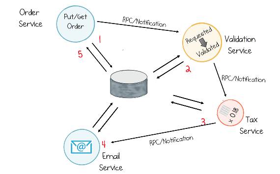
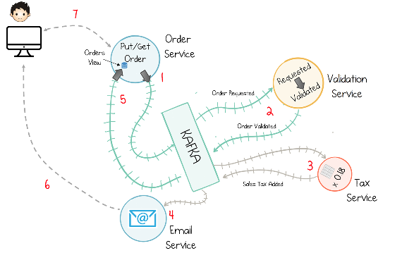
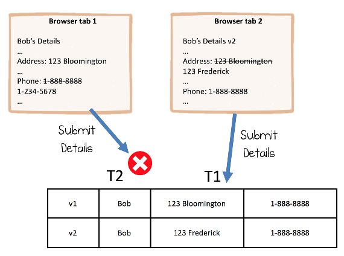

# CHAPTER 11 &emsp; Consistency and Concurrency in Event-Driven Systems

<div align="justify">

The term *consistency* is quite overused in our industry, with several different meanings applied in a range of contexts. Consistency in CAP theorem differs from consistency in ACID transactions, and there is a whole spectrum of subtly different guarantees, including strong consistency and eventual consistency, among others. The lack of consistent terminology around this word may seem a little ironic, but it is really a reflection of the complexity of a subject that goes way beyond the scope of this book.1

But despite these many subtleties, most people have an intuitive notion of what consistency is, one often formed from writing single-threaded programs2 or making use of a database. This typically equates to some general notions about the transactional guarantees a database provides. When you write a record, it stays written. When you read a record, you read the most recently written value. If you perform multiple operations in a transaction, they all become visible at once, and you don’t need to be concerned with what other users may be doing at the same time. We might call this idea *intuitive consistency* (which is closest in technical terms to the famous ACID properties).

A common approach to building business systems is to take this intuitive notion and apply it directly. If you build traditional three-tier applications (i.e., client, server, and database), this is often what you would do. The database manages concurrent changes, isolated from other users, and everyone observes exactly the same view at any one point in time. But groups of services generally don’t have such strong guarantees. A set of microservices might call one another synchronously, but as data moves from service to service it will often become visible to users at different times, unless all services coordinate around a single database and force the use of a single global consistency model.

But in a world where applications are distributed (across geographies, devices, etc.), it isn’t always desirable to have a single, global consistency model. If you create data on a mobile device, it can only be consistent with data on a backend server if the two are connected. When disconnected, they will be, by definition, inconsistent (at least in that moment) and will synchronize at some later point, eventually becoming consistent. But designing systems that handle periods of inconsistency is important. For a mobile device, being able to function offline is a desirable feature, as is resynchronizing with the backend server when it reconnects, converging to consistency as it does so. But the usefulness of this mode of operation depends on the specific work that needs to be done. A mobile shopping application might let you select your weekly groceries while you’re offline, but it can’t work out whether those items will be available, or let you physically buy anything until you come back online again. So these are use cases where global strong consistency is undesirable.

Business systems often don’t need to work offline in this way, but there are still benefits to avoiding global strong consistency and distributed transactions: they are difficult and expensive to scale, don’t work well across geographies, and are often relatively slow. In fact, experience with distributed transactions that span different systems, using techniques like XA, led the majority of implementers to design around the need for such expensive coordination points.

But on the other hand, business systems typically want strong consistency to reduce the potential for errors, which is why there are vocal proponents who consider stronger safety properties valuable. There is also an argument for wanting a bit of both worlds. This middle ground is where event-driven systems sit, often with some form of eventual consistency.


## Eventual Consistency

The previous section refers to an intuitive notion of consistency: the idea that business operations execute sequentially on a single copy of data. It’s quite easy in to build a system that has this property. Services call one another through RPCs, just like methods in a single-threaded program: a set of sequential operations. Data is passed by reference, using an ID. Each service looks up the data it needs in the database. When it needs to change it, it changes it in the database. Such a system might look something like Figure 11-1.

<div align="center">



*Figure 11-1. A set of services that notify one another and share data via a database*

</div>

This approach provides a very intuitive model as everything progresses sequentially, but as services scale out and more services are added, it can get hard to scale and operate systems that follow this approach.

Event-driven systems aren’t typically built in this way. Instead, they leverage asynchronous broadcast, deliberately removing the need for global state and avoiding synchronous execution. (We went through the issues with global shared state in “What Happens to Systems as They Evolve?” on page 80 in Chapter 8.) Such systems are often referred to as being “eventually consistent.”

There are two consequences of eventual consistency in this context:

*Timeliness*  
If two services process the same event stream, they will process them at different rates, so one might lag behind the other. If a business operation consults both services for any reason, this could lead to an inconsistency.

*Collisions*  
If different services make changes to the same entity in the same event stream, if that data is later coalesced—say in a database—some changes might be lost.

Let’s dig into these with an example that continues our theme of online retail systems. In Figure 11-2 an order is accepted in the orders service (1). This is picked up by the validation service, where it is validated (2). Sales tax is added (3). An email is sent (4). The updated order goes back to the orders service (5), where it can be queried via the orders view (this is an implementation of CQRS, as we discussed in Chapter 7). After being sent a confirmation email (6), the user can click through to the order (7).

<div align="center">



*Figure 11-2. An event-driven system connected via a log*

</div>


## Timeliness

Consider the email service (4) and orders view (5). Both subscribe to the same event stream (Validated Orders) and process them concurrently. Executing concurrently means one will lag slightly behind the other. Of course, if we stopped writes to the system, then both the orders view and the email service would *eventually converge* on the same state, but in normal operation they will be at slightly different positions in the event stream. So they lack timeliness with respect to one another. This could cause an issue for a user, as there is an indirect connection between the email service and the orders service. If the user clicks the link in the confirmation email, but the view in the orders service is lagging, the link would either fail or return an incorrect state (7).

So a lack of timeliness (i.e., lag) can cause problems if services are linked in some way, but in larger ecosystems it is beneficial for the services to be decoupled, as it allows them to do their work concurrently and in isolation, and the issues of timeliness can usually be managed (this relates closely to the discussion around CQRS in Chapter 7).

But what if this behavior is unacceptable, as this email example demonstrates? Well, we can always add serial execution back in. The call to the orders service might block until the view is updated (this is the approach taken in the worked example in Chapter 15). Alternatively, we might have the orders service raise a View Updated event, used to trigger the email service after the view has been updated. Both of these synthesize serial execution where it is necessary.


### Collisions and Merging

Collisions occur if two services update the same entity at the same time. If we design the system to execute serially, this won’t happen, but if we allow concurrent execution it can.

Consider the validation service and tax service in Figure 11-2. To make them run serially, we might force the tax service to execute first (by programming the service to react to Order Requested events), then force the validation service to execute next (by programming the service to react to events that have had sales tax added). This linearizes execution for each order and means that the final event will have all the information in (i.e., it is both validated and has sales tax added). Of course, making events run serially in this way increases the end-to-end latency.

Alternatively, we can let the validation service and the tax service execute concurrently, but we’d end up with two events with important information in each: one validated order and one order with sales tax added. This means that, to get the correct order, with both validation and sales tax applied, we would have to merge these two messages. (So, in this case, the merge would have to happen in both the email service and in the orders view.)

In some situations this ability to make changes to the same entity in different processes at the same time, and merge them later, can be extremely powerful (e.g., an online whiteboarding tool). But in others it can be error-prone. Typically, when building business systems, particularly ones involving money and the like, we tend to err on the side of caution. There is a formal technique for merging data in this way that has guaranteed integrity; it is called a conflict-free replicated data type, or CRDT. CRDTs essentially restrict what operations you can perform to ensure that, when data is changed and later merged, you don’t lose information. The downside is that the dialect is relatively limited.

A good compromise for large business systems is to keep the lack of timeliness (which allows us to have lots of replicas of the same state, available read-only) but remove the opportunity for collisions altogether (by disallowing concurrent mutations). We do this by allocating a single writer to each type of data (topic) or alternatively to each state transition. We’ll talk about this next.


## The Single Writer Principle

A useful way to generify these ideas is to isolate consistency concerns into owning services using the *single writer principle*. Martin Thompson used this term in response to the wide-scale use of locks in concurrent environments, and the subsequent efficiencies that we can often gain by consolidating writes to a single thread. The core idea closely relates to the Actor model,3 several ideas in database research,4 and anecdotally to system design. From a services perspective, it also marries with the idea that services should have a single responsibility.

At its heart it’s a simple concept: *responsibility for propagating events of a specific type is assigned to a single service—a single writer*. So the inventory service owns how the stock inventory progresses over time, the orders service owns the progression of orders, and so on.

Conflating writes into a single service makes it easier to manage consistency efficiently. But this principle has worth that goes beyond correctness or concurrency properties. For example:

- It allows versioning (e.g., applying a version number) and consistency checks (e.g., checking a version number; see “Identity and Concurrency Control” on page 108) to be applied in a single place.
- It isolates the logic for evolving each business entity, in time, to a single service, making it easier to reason about and to change (for example, rolling out a schema change, as discussed in “Handling Schema Change and Breaking Backward Compatibility” on page 124 in Chapter 13).
- It dedicates ownership of a dataset to a single team, allowing that team to specialize. One antipattern observed in industry, when Enterprise Messaging or an Enterprise Service Bus was applied, was that centralized schemas and business logic could become a barrier to progress.5 The single writer principle encourages service teams with clearly defined ownership of shared datasets, putting focus on data on the outside as well as allocating clear responsibility for it. This becomes important in domains that have complex business rules associated with different types of data. So, for example, in finance, where products require rich domain knowledge to model and evolve, isolating responsibility for data evolution to a single service and team is often considered an advantage.

When the single writer principle is applied in conjunction with Event Collaboration (discussed in Chapter 5), each writer evolves part of a single business workflow through a set of successive events. So in Figure 11-3, which shows a larger online retail workflow, several services collaborate around the order process as an order moves from inception, through payment processing and shipping, to completion. There are separate topics for order, payment, and shipment. The order, payment, and shipping services take control of all state changes made in their respective topics.

<div align="center">


*Figure 11-3. Here each circle represents an event; the color of the circle designates the topic it is in; a workflow evolves from Order Requested through to Order Completed; on the way, four services perform different state transitions in topics they are “single writer” to; the overall workflow spans them all*

</div>

So, instead of sharing a global consistency model (e.g., via a database), we use the single writer principle to create local points of consistency that are connected via the event stream. There are a couple of variants on this pattern, which we will discuss in the next two sections.

As we’ll see in “Scaling Concurrent Operations in Streaming Systems” on page 142 in Chapter 15, single writers can be scaled out linearly through partitioning, if we use Kafka’s Streams API.


### Command Topic

A common variant on this pattern uses two topics per entity, often named Command and Entity. This is logically identical to the base pattern, but the Command topic can be written to by any process and is used only for the initiating event. The Entity topic can be written to only by the owning service: the single writer. Splitting these two allows administrators to enforce the single writer principle strictly by configuring topic permissions. So, for example, we might break order events into two topics, shown in Table 11-1.

*Table 11-1. A Command Topic is used to separate the initial command from subsequent events*

<table>
    <tr>
        <th scope="row">Topic</th>
        <td>OrderCommandTopic</td>
        <td>OrdersTopic</td>
    </tr>
    <tr>
        <th scope="row">Event types</th>
        <td>OrderRequest(ed)</td>
        <td>OrderValidated, OrderCompleted</td>
    </tr>
    <tr>
        <th scope="row">Writer</th>
        <td>Any service</td>
        <td>Orders service</td>
    </tr>
</table>


### Single Writer Per Transition

A less stringent variant of the single writer principle involves services owning individual transitions rather than all transitions in a topic (see Table 11-2). So, for example, the payment service might not use a Payment topic at all. It might simply add extra payment information to the existing order message (so there would be a Payment section of the Order schema). The payment service then owns just that one transition and the orders service owns the others.

*Table 11-2. The order service and payment services both write to the orders topic, but each service is responsible for a different state transition*

<table>
    <tr>
        <th scope="row">Service</th>
        <td>Order service</td>
        <td>Payment service</td>
    </tr>
    <tr>
        <th scope="row">Topic</th>
        <td>OrdersTopic</td>
        <td>OrdersTopic</td>
    </tr>
    <tr>
        <th scope="row">Writable transition</th>
        <td>OrderRequested->OrderValidated<br>PaymentReceived->OrderConfirmed</td>
        <td>OrderValidated->PaymentReceived</td>
    </tr>
</table>


## Atomicity with Transactions
 
Kafka provides a transactions feature with two guarantees:

- Messages sent to different topics, within a transaction, will either all be written or none at all.
- Messages sent to a single topic, in a transaction, will never be subject to duplicates, even on failure.

But transactions provide a very interesting and powerful feature to Kafka Streams: they join writes to state stores and writes to output topics together, atomically. Kafka’s transactions are covered in full in Chapter 12


## Identity and Concurrency Control

The notion of identity is hugely important in business systems, yet it is often overlooked. For example, to detect duplicates, messages need to be uniquely identified, as we discussed in Chapter 12. Identity is also important for handling the potential for updates to be made at the same time, by implementing optimistic concurrency control.

The basic premise of identity is that it should correlate with the real world: an order has an `OrderId`, a payment has a `PaymentId`, and so on. If that entity is logically mutable (for example, an order that has several states, `Created`, `Validated`, etc., or a customer whose email address might be updated), then it should have a version identifier also:

```
    "Consumer" {
            "CustomerId": "1234"
            "Source": "ConfluentWebPortal"
            "Version": "1"
            ...
    }
```

The version identifier can then be used to handle concurrency. As an example (see Figure 11-4), say a user named Bob opens his customer details in one browser window (reading version 1), then opens the same page in a second browser window (also version 1). He then changes his address and submits in the second window, so the server increments the version to 2. If Bob goes back to the first window and changes his phone number, the update should be rejected due to a version comparison check on the server.

<div align="center">



*Figure 11-4. An example of optimistic concurrency control. The write fails at T2 because the data in the browser is now stale and the server performs a version number comparison before permitting the write.*

</div>

The optimistic concurrency control technique can be implemented in synchronous or asynchronous systems equivalently.


## Limitations

The single writer principle and other related patterns discussed in this chapter are exactly that: patterns, which are useful in common cases, but don’t provide general solutions. There will always be exceptions, particularly in environments where the implementation is constrained, for example, by legacy systems.


## Summary

In this chapter we looked at why global consistency can be problematic and why eventual consistency can be useful. We adapted eventual consistency with the single writer principle, keeping its lack of timeliness but avoiding collisions. Finally, we looked at implementing identity and concurrency control in event- driven systems.

---

1 For a full treatment, see Martin Kleppmann’s encyclopedic *Designing Data-Intensive Applications*
(Sebastopol, CA: O’Reilly, 2017).

2 The various consistency models really reflect optimizations on the concept of in-order execution against a single copy of data. These optimizations are necessary in practice, and most users would prefer to trade a slightly weaker guarantee for the better performance (or availability) characteristics that typically come with them. So implementers come up with different ways to slacken the simple “in-order execution” guarantee. These various optimizations lead to different consistency models, and because there are many dimensions to optimize, particularly in distributed systems, there are many resulting models.  
When we discuss “Scaling Concurrent Operations in Streaming Systems” on page 142 in Chapter 15, we’ll see how streaming systems achieve strong guarantees by partitioning relevant data into different stream threads, then wrapping those operations in a transaction, which ensures that, for that operation, we have in-order execution on a single copy of data (i.e., a strong consistency model).

3 *https://dspace.mit.edu/handle/1721.1/6952* and *https://en.wikipedia.org/wiki/Actor_model*.

4 *See http://bit.ly/deds-end-of-an-era* and *http://bit.ly/deds-volt*.

5 See *https://thght.works/2IUS1zS* and *https://thght.works/2GdFYMq*.

</div>