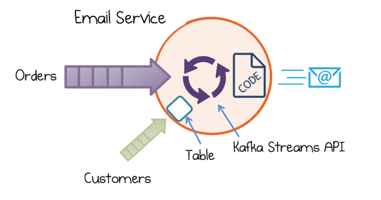
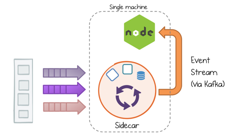
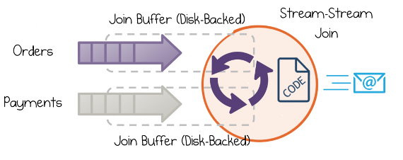
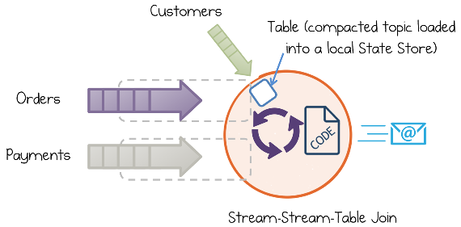
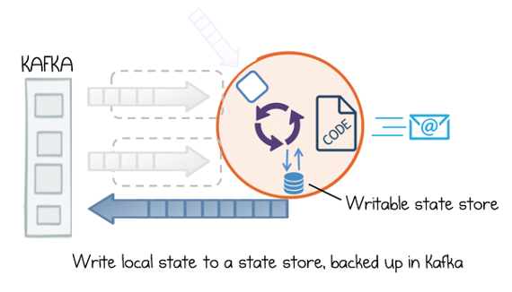

# CHAPTER 14 &emsp; Kafka Streams and KSQL

<div align="justify">

When it comes to building event-driven services, the Kafka Streams API provides the most complete toolset for handling a distributed, asynchronous world. Kafka Streams is designed to perform streaming computations. We discussed a simple example of such a use case, where we processed app open/close events emitted from mobile phones in Chapter 2. We also touched on its stateful elements in Chapter 6. This led us to three types of services we can build: event-driven, streaming, and stateful streaming.

In this chapter we look more closely at this unique tool for stateful stream processing, along with its powerful declarative interface: KSQL.


## A Simple Email Service Built with Kafka Streams and KSQL

Kafka Streams is the core API for stream processing on the JVM (Java, Scala, Clojure, etc.). It is based on a DSL (domain-specific language) that provides a declaratively styled interface where streams can be joined, filtered, grouped, or aggregated via the DSL itself. It also provides functionally styled mechanisms (`map`, `flatMap`, `transform`, `peek`, etc.) for adding bespoke processing of messages one at a time. Importantly, you can blend these two approaches together in the services you build, with the declarative interface providing a high-level abstraction for SQL-like operations and the more functional methods adding the freedom to branch out into any arbitrary code you may wish to write.

But what if you’re not running on the JVM? In this case you’d use KSQL. KSQL provides a simple, interactive SQL-like wrapper for the Kafka Streams API. It can be run standalone, for example, via the Sidecar pattern, and called remotely. As KSQL utilizes the Kafka Streams API under the hood, we can use it to do the same kind of declarative slicing and dicing. We can also apply custom processing either by implementing a user-defined function (UDF) directly or, more commonly, by pushing the output to a Kafka topic and using a native Kafka client, in whatever language our service is built in, to process the manipulated streams one message at a time. Whichever approach we take, these tools let us model business operations in an asynchronous, nonblocking, and coordination-free manner.

Let’s consider something more concrete. Imagine we have a service that sends emails to platinum-level clients (Figure 14-1). We can break this problem into two parts. First, we prepare by joining a stream of orders to a table of customers and filtering for the “platinum” clients. Second, we need code to construct and send the email itself. We would do the former in the DSL and the latter with a per-message function:

```
    //Join customers and orders
    orders.join(customers, Tuple::new)
     //Consider confirmed orders for platinum customers
     .filter((k, tuple) -> tuple.customer.level().equals(PLATINUM)
     && tuple.order.state().equals(CONFIRMED))
     //Send email for each customer/order pair
     .peek((l, tuple) -> emailer.sendMail(tuple));
```

<table>
    <tr>
        <td>
            
        </td>
        <td>
            The code for this is available on GitHub.
        </td>
    </tr>
</table>

<div align="center">



*Figure 14-1. An example email service that joins orders and customers, then sends an email*

</div>

We can perform the same operation using KSQL (Figure 14-2). The pattern is the same; the event stream is dissected with a declarative statement, then processed one record at a time:

```
    //Create a stream of confirmed orders for platinum customers
    ksql> CREATE STREAM platinum_emails AS SELECT * FROM orders
        WHERE client_level == 'PLATINUM' AND state == 'CONFIRMED';
```

Then we implement the emailer as a simple consumer using Kafka’s Node.js API (though a wide number of languages are supported) with KSQL running as a sidecar.

<div align="center">



*Figure 14-2. Executing a streaming operation as a sidecar, with the resulting stream being processed by a Node.js client*

</div>


## Windows, Joins, Tables, and State Stores

Chapter 6 introduced the notion of holding whole tables inside the Kafka Streams API, making services stateful. Here we look a little more closely at how both streams and tables are implemented, along with some of the other core features.

Let’s revisit the email service example once again, where an email is sent to confirm payment of a new order, as pictured in Figure 14-3. We apply a stream-stream join, which waits for corresponding Order and Payment events to both be present in the email service before triggering the email code. The join behaves much like a logical AND.

<div align="center">



*Figure 14-3. A stream-stream join between orders and payments*

</div>

Incoming event streams are buffered for a defined period of time (denoted retention). But to avoid doing all of this buffering in memory, state stores—disk-backed hash tables—overflow the buffered streams to disk. Thus, regardless of which event turns up later, the corresponding event can be quickly retrieved from the buffer so the join operation can complete.

Kafka Streams also manages whole tables. Tables are a local manifestation of a complete topic—usually compacted—held in a state store by key. (You might also think of them as a stream with infinite retention.) In a services context, such tables are often used for enrichments. So to look up the customer’s email, we might use a table loaded from the Customers topic in Kafka.

The nice thing about using a table is that it behaves a lot like tables in a database. So when we join a stream of orders to a table of customers, there is no need to worry about retention periods, windows, or other such complexities. Figure 14-4 shows a three-way join between orders, payments, and customers, where customers are represented as a table.

<div align="center">



*Figure 14-4. A three-way join between two streams and a table*

</div>

There are actually two types of table in Kafka Streams: KTables and Global KTables. With just one instance of a service running, these behave equivalently. However, if we scaled our service out—so it had four instances running in parallel—we’d see slightly different behaviors. This is because Global KTables are broadcast: each service instance gets a complete copy of the entire table. Regular KTables are partitioned: the dataset is spread over all service instances.

Whether a table is broadcast or partitioned affects the way it can perform joins. With a Global KTable, because the whole table exists on every node, we can join to any attribute we wish, much like a foreign key join in a database. This is not true in a KTable. Because it is partitioned, it can be joined only by its primary key, just like you have to use the primary key when you join two streams. So to join a KTable or stream by an attribute that is not its primary key, we must perform a repartition. This is discussed in “Rekey to Join” on page 145 in Chapter 15.

So, in short, Global KTables work well as lookup tables or star joins but take up more space on disk because they are broadcast. KTables let you scale your services out when the dataset is larger, but may require that data be rekeyed.1

The final use of the state store is to save information, just like we might write data to a regular database (Figure 14-5). Anything we save can be read back again later, say after a restart. So we might expose an Admin interface to our email service that provides statistics on emails that have been sent. We could store, these stats in a state store and they’ll be saved locally as well as being backed up to Kafka, using what’s called *a changelog topic*, inheriting all of Kafka’s durability guarantees.

<div align="center">



*Figure 14-5. Using a state store to keep application-specific state within the Kafka Streams API as well as backed up in Kafka*

</div>


## Summary

This chapter provided a brief introduction to streams, tables, and state stores: three of the most important elements of a streaming application. Streams are infinite and we process them a record at a time. Tables represent a whole dataset, materialized locally, which we can join to much like a database table. State stores behave like dedicated databases which we can read and write to directly with any information we might wish to store. These features are of course just the tip of the iceberg, and both Kafka Streams and KSQL provide a far broader set of features, some of which we explore in Chapter 15, but they all build on these base concepts.

---

1 The difference between these two is actually slightly subtler.

</div>