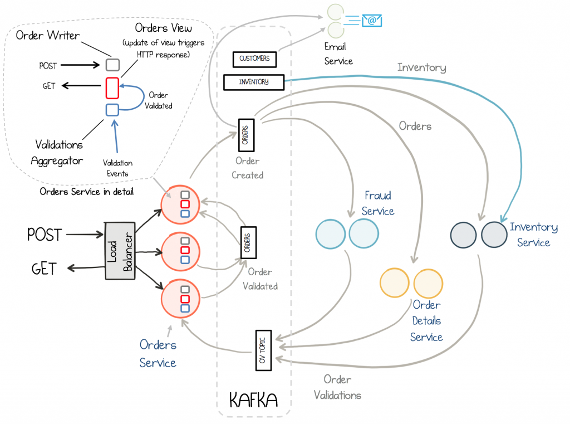
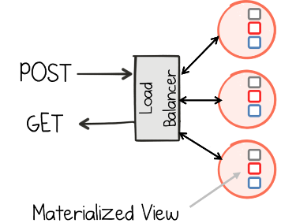
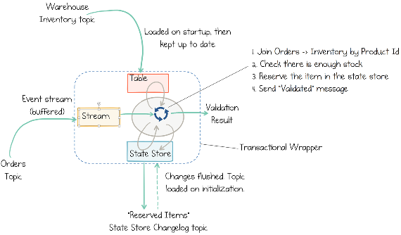
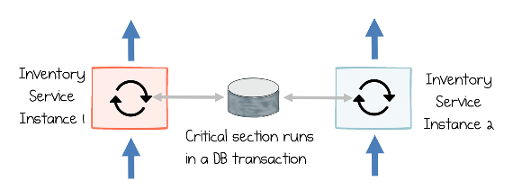
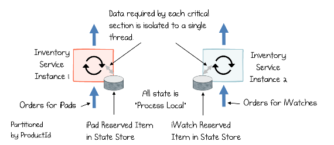
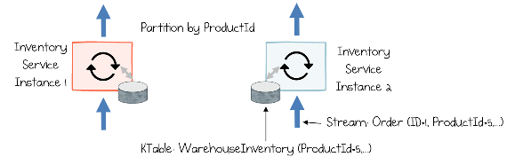
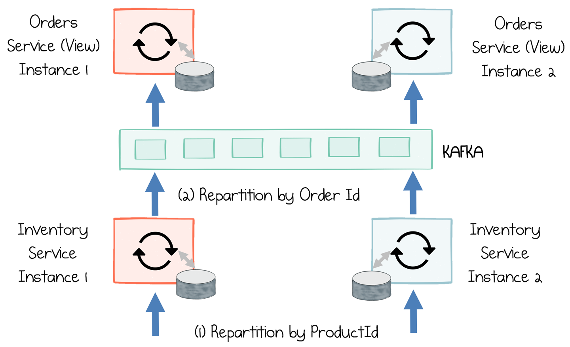
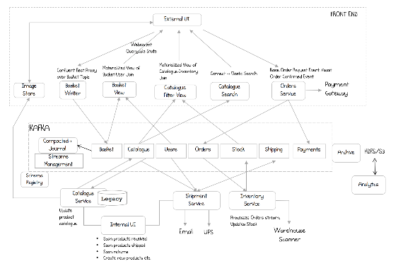

# CHAPTER 15 &emsp; Building Streaming Services

<div align="justify">

## An Order Validation Ecosystem

Having developed a basic understanding of Kafka Streams, now let’s look at the techniques needed to build a small streaming services application. We will base this chapter around a simple order processing workflow that validates and processes orders in response to HTTP requests, mapping the synchronous world of a standard REST interface to the asynchronous world of events, and back again.

<table>
    <tr>
        <td>
            
        </td>
        <td>
            Download the code for this example from GitHub.
        </td>
    <tr>
</table>

Starting from the lefthand side of the Figure 15-1, the REST interface provides methods to POST and GET orders. Posting an order creates an Order Created event in Kafka. Three validation engines (Fraud, Inventory, Order Details) subscribe to these events and execute in parallel, emitting a PASS or FAIL based on whether each validation succeeds. The result of these validations is pushed through a separate topic, Order Validations, so that we retain the single writer relationship between the orders service and the Orders topic.1 The results of the various validation checks are aggregated back in the orders service, which then moves the order to a Validated or Failed state, based on the combined result. Validated orders accumulate in the Orders view, where they can be queried historically. This is an implementation of the CQRS design pattern (see “Command Query Responsibility Segregation” on page 61 in Chapter 7). The email service sends confirmation emails.

<div align="center">



*Figure 15-1. An order processing system implemented as streaming services*

</div>

The inventory service both validates orders and reserves inventory for the purchase—an interesting problem, as it involves tying reads and writes together atomically. We look at this in detail later in this chapter.


## Join-Filter-Process

Most streaming systems implement the same broad pattern where a set of streams is prepared, and then work is performed one event at a time. This involves three steps:

1. **Join.** The DSL is used to join a set of streams and tables emitted by other services.
2. **Filter.** Anything that isn’t required is filtered. Aggregations are often used here too.
3. **Process.** The join result is passed to a function where business logic executes. The output of this business logic is pushed into another stream.

This pattern is seen in most services but is probably best demonstrated by the email service, which joins orders, payments, and customers, forwarding the result to a function that sends an email. The pattern can be implemented in either Kafka Streams or KSQL equivalently.


## Event-Sourced Views in Kafka Streams

To allow users to perform a HTTP GET, and potentially retrieve historical orders, the orders service creates a queryable event-sourced view. (See “The Event-Sourced View” on page 71 in Chapter 7.) This works by pushing orders into a set of state stores partitioned over the three instances of the Orders view, allowing load and storage to be spread between them.

<div align="center">



*Figure 15-2. Close-up of the Orders Service, from Figure 15-1, demonstrating the materialized view it creates which can be accessed via an HTTP GET; the view represents the Query-side of the CQRS pattern and is spread over all three instances of the Orders Service*

</div>

Because data is partitioned it can be scaled out horizontally (Kafka Streams supports dynamic load rebalancing), but it also means GET requests must be routed to the right node—the one that has the partition for the key being requested. This is handled automatically via the interactive queries functionality in Kafka Streams.2

There are actually two parts to this. The first is the query, which defines what data goes into the view. In this case we are grouping orders by their key (so new orders overwrite old orders), with the result written to a state store where it can be queried. We might implement this with the Kafka Streams DSL like so:

```
    builder.stream(ORDERS.name(), serializer)
           .groupByKey(groupSerializer)
           .reduce((agg, newVal) -> newVal, getStateStore())
```

The second part is to expose the state store(s) over an HTTP endpoint, which is simple enough, but when running with multiple instances requests must be routed to the correct partition and instance for a certain key. Kafka Streams includes a metadata service that does this for you.


## Collapsing CQRS with a Blocking Read

The orders service implements a blocking HTTP GET so that clients can read their own writes. This technique is used to collapse the asynchronous nature of the CQRS pattern. So, for example, if a client wants to perform a write operation, immediately followed by a read, the event might not have propagated to the view, meaning they would either get an error or an incorrect value.

One solution is to block the GET operation until the event arrives (or a configured timeout passes), collapsing the asynchronicity of the CQRS pattern so that it appears synchronous to the client. This technique is essentially long polling. The orders service, in the example code, implements this technique using nonblocking IO.


## Scaling Concurrent Operations in Streaming Systems

The inventory service is interesting because it needs to implement several specialist techniques to ensure it works accurately and consistently. The service performs a simple operation: when a user purchases an iPad, it makes sure there are enough iPads available for the order to be fulfilled, then physically reserves a number of them so no other process can take them (Figure 15-3). This is a little trickier than it may seem initially, as the operation involves managing atomic state across topics. Specifically:

1. Validate whether there are enough iPads in stock (inventory in warehouse minus items reserved).
2. Update the table of “reserved items” to reserve the iPad so no one else can take it.
3. Send out a message that validates the order.

<div align="center">



*Figure 15-3. The inventory service validates orders by ensuring there is enough inventory in stock, then reserving items using a state store, which is backed by Kafka; all operations are wrapped in a transaction*

</div>

This will work reliably only if we:

- Enable Kafka’s transactions feature.
- Ensure that data is partitioned by ProductId before this operation is performed.

The first point should be pretty obvious: if we fail and we’re not wrapped in a transaction, we have no idea what state the system will be in. But the second point should be a little less clear, because for it to make sense we need to think about this particular operation being scaled out linearly over several different threads or machines.

Stateful stream processing systems like Kafka Streams have a novel and high- performance mechanism for managing stateful problems like these concurrently. We have a single critical section:

1. Read the number of unreserved iPads currently in stock.
2. Reserve the iPads requested on the order.

Let’s first consider how a traditional (i.e., not stateful) streaming system might work (Figure 15-4). If we scale the operation to run over two parallel processes, we would run the critical section inside a transaction in a (shared) database. So both instances would bottleneck on the same database instance.

<div align="center">



*Figure 15-4. Two instances of a service manage concurrent operations via a shared database*

</div>

Stateful stream processing systems like Kafka Streams avoid remote transactions or cross-process coordination. They do this by *partitioning* the problem over a set of threads or processes using a chosen business *key*. (“Partitions and Partitioning” was discussed in Chapter 4.) This provides the key (no pun intended) to scaling these systems horizontally.

Partitioning in Kafka Streams works by rerouting messages so that all the state required for one particular computation is sent to a single thread, where the computation can be performed.3 The approach is inherently parallel, which is how streaming systems achieve such high message-at-a-time processing rates (for example, in the use case discussed in Chapter 2). But the approach works only if there is a logical key that cleanly segregates all operations: both state that they need, and state they operate on.

So splitting (i.e., partitioning) the problem by ```ProductId``` ensures that all operations for one ```ProductId``` will be sequentially executed on the same thread. That means all iPads will be processed on one thread, all iWatches will be processed on one (potentially different) thread, and the two will require no coordination between each other to perform the critical section (Figure 15-5). The resulting operation is atomic (thanks to Kafka’s transactions), can be scaled out horizontally, and requires no expensive cross-network coordination. (This is similar to the Map phase in MapReduce systems.)

<div align="center">



*Figure 15-5. Services using the Kafka Streams API partition both event streams and stored state across the various services, which means all data required to run the critical section exists locally and is accessed by a single thread*

</div>

The inventory service must rearrange orders so they are processed by ProductId. This is done with an operation called a *rekey*, which pushes orders into a new intermediary topic in Kafka, this time keyed by ```ProductId```, and then back out to the inventory service. The code is very simple:

```
    orders.selectKey((id, order) -> order.getProduct())//rekey by ProductId
```

Part 2 of the critical section is a state mutation: inventory must be reserved. The inventory service does this with a Kafka Streams state store (a local, disk-resident hash table, backed by a Kafka topic). So each thread executing will have a state store for “reserved stock” for some subset of the products. You can program with these state stores much like you would program with a hash map or key/value store, but with the benefit that all the data is persisted to Kafka and restored if the process restarts. A state store can be created in a single line of code:

```
    KeyValueStore<Product, Long> store = context.getStateStore(RESERVED);
```

Then we make use of it, much like a regular hash table:

```
    //Get the current reserved stock for this product
    Long reserved = store.get(order.getProduct());
    //Add the quantity for this order and submit it back
    store.put(order.getProduct(), reserved + order.getQuantity())
```

Writing to the store also partakes in Kafka’s transactions, discussed in Chapter 12.


## Rekey to Join

We can apply exactly the same technique used in the previous section, for partitioning writes, to partitioning reads (e.g., to do a join). Say we want to join a stream of orders (keyed by ```OrderId```) to a table of warehouse inventory (keyed by ```ProductId```), as we do in Figure 15-3. The join will have to use the ```ProductId```.
 
This is what would be termed a foreign key relationship in relational parlance, mapping from ```WarehouseInventory.ProductId``` (its primary key) onto ```Order.ProductId``` (which isn’t its primary key). To do this, we need to shuffle orders across the different nodes so that the orders end up being processed in the same thread that has the corresponding warehouse inventory assigned.

As mentioned earlier, this data redistribution step is called a *rekey*, and data arranged in this way is termed co-partitioned. Once rekeyed, the join condition can be performed without any additional network access required. For example, in Figure 15-6, inventory with ```productId=5``` is collocated with orders for ```productId=5```.

<div align="center">



*Figure 15-6. To perform a join between orders and warehouse inventory by ProductId, orders are repartitioned by ProductId, ensuring that for each product all corresponding orders will be on the same instance*

</div>


## Repartitioning and Staged Execution

Real-world systems are often more complex. One minute we’re performing a join, the next we’re aggregating by customer or materializing data in a view, with each operation requiring a different data distribution profile. Different operations like these chain together in a pipeline. The inventory service provides a good example of this. It uses a rekey operation to distribute data by ```ProductId```. Once complete, it has to be rekeyed back to ```OrderId``` so it can be added to the Orders view (Figure 15-7). (The Orders view is destructive—that is, old versions of an order will be replaced by newer ones—so it’s important that the stream be keyed by ```OrderId``` so that no data is lost.)

<div align="center">



*Figure 15-7. Two stages, which require joins based on different keys, are chained together via a rekey operation that changes the key from ProductId to OrderId*

</div>

There are limitations to this approach, though. The *keys used to partition the event streams must be invariant if ordering is to be guaranteed*. So in this particular case it means the keys, ```ProductId``` and ```OrderId```, on each order must remain fixed across all messages that relate to that order. Typically, this is a fairly easy thing to manage at a domain level (for example, by enforcing that, should a user want to change the product they are purchasing, a brand new order must be created).


## Waiting for N Events

Another relatively common use case in business systems is to wait for *N* events to occur. This is trivial if each event is located in a different topic—it’s simply a three-way join—but if events arrive on a single topic, it requires a little more thought.

The orders service, in the example discussed earlier in this chapter (Figure 15-1), waits for validation results from each of the three validation services, all sent via the same topic. Validation succeeds holistically only if all three return a ```PASS```. Assuming you are counting messages with a certain key, the solution takes the form:

1. Group by the key.
2. Count occurrences of each key (using an aggregator executed with a window).
3. Filter the output for the required count.


## Reflecting on the Design

Any distributed system comes with a baseline cost. This should go without saying. The solution described here provides good scalability and resiliency properties, but will always be more complex to implement and run than a simple, single-process application designed to perform the same logic. You should always carefully weigh the tradeoff between better nonfunctional properties and simplicity when designing a system. Having said that, a real system will inevitably be more complex, with more moving parts, so the pluggability and extensibility of this style of system can provide a worthy return against the initial upfront cost.


## A More Holistic Streaming Ecosystem

In this final section we take a brief look at a larger ecosystem (Figure 15-8) that pulls together some of the main elements discussed in this book thus far, outlining how each service contributes, and the implementation patterns each might use:

<div align="center">



*Figure 15-8. A more holistic streaming ecosystem*

</div>

*Basket writer/view*  
These represent an implementation of CQRS, as discussed in “Command Query Responsibility Segregation” on page 61 in Chapter 7. The Basket writer proxies HTTP requests, forwarding them to the Basket topic in Kafka when a user adds a new item. The Confluent REST proxy (which ships with the Confluent distribution of Kafka) is used for this. The Basket view is an event-sourced view, implemented in Kafka Streams, with the contents of its state stores exposed over a REST interface in a manner similar to the orders service in the example discussed earlier in this chapter (Kafka Connect and a database could be substituted also). The view represents a join between User and Basket topics, but much of the information is thrown away, retaining only the bare minimum: ```userId → List[product]```. This minimizes the view’s footprint.

*The Catalogue Filter view*  
This is another event-sourced view but requires richer support for pagination, so the implementation uses Kafka Connect and Cassandra.

*Catalogue search*  
A third event-sourced view; this one uses Solr for its full-text search capabilities.

*Orders service*  
Orders are validated and saved to Kafka. This could be implemented either as a single service or a small ecosystem like the one detailed earlier in this chapter.

*Catalog service*  
A legacy codebase that manages changes made to the product catalog, initiated from an internal UI. This has comparatively fewer users, and an existing codebase. Events are picked up from the legacy Postgres database using a CDC connector to push them into Kafka. The single-message transforms feature reformats the messages before they are made public. Images are saved to a distributed filesystem for access by the web tier.

*Shipping service*  
A streaming service leveraging the Kafka Streams API. This service reacts to orders as they are created, updating the Shipping topic as notifications are received from the delivery company.

*Inventory service*  
Another streaming service leveraging the Kafka Streams API. This service updates inventory levels as products enter and leave the warehouse.

*Archive*  
All events are archived to HDFS, including two, fixed T-1 and T-10 point-in- time snapshots for recovery purposes. This uses Kafka Connect and its HDFS connector.

*Streams management*  
A set of stream processors manages creating latest/versioned topics where relevant (see the Latest-Versioned pattern in “Long-Term Data Storage” on page 25 in Chapter 3). This layer also manages the swing topics used when non-backward-compatible schema changes need to be rolled out. (See “Handling Schema Change and Breaking Backward Compatibility” on page 124 in Chapter 13.)

*Schema Registry*  
The Confluent Schema Registry provides runtime validation of schemas and their compatibility.


## Summary

When we build services using a streaming platform, some will be stateless—simple functions that take an input, perform a business operation, and produce an output. Some will be stateful, but read only, as in event-sourced views. Others will need to both read and write state, either entirely inside the Kafka ecosystem (and hence wrapped in Kafka’s transactional guarantees), or by calling out to other services or databases. One of the most attractive properties of a stateful stream processing API is that all of these options are available, allowing us to trade the operational ease of stateless approaches for the data processing capabilities of stateful ones.

But there are of course drawbacks to this approach. While standby replicas, checkpoints, and compacted topics all mitigate the risks of pushing data to code, there is always a worst-case scenario where service-resident datasets must be rebuilt, and this should be considered as part of any system design.

There is also a mindset shift that comes with the streaming model, one that is inherently more asynchronous and adopts a more functional and data-centric style, when compared to the more procedural nature of traditional service interfaces. But this is—in the opinion of this author—an investment worth making.

In this chapter we looked at a very simple system that processes orders. We did this with a set of small streaming microservices that implement the Event Collaboration pattern we discussed in Chapter 5. Finally, we looked at how we can create a larger architecture using the broader range of patterns discussed in this book.

---

1 In this case we choose to use a separate topic, Order Validations, but we might also choose to update the Orders topic directly using the single-writer-per-transition approach discussed in Chapter 11.

2 It is also common practice to implement such event-sourced views via Kafka Connect and your data‐ base of choice, as we discussed in “Query a Read-Optimized View Created in a Database” on page 69 in Chapter 7. Use this method when you need a richer query model or greater storage capacity.

3 As an aside, one of the nice things about this feature is that it is managed by Kafka, not Kafka Streams. Kafka’s Consumer Group Protocol lets any group of consumers control how partitions are distributed across the group.

</div>