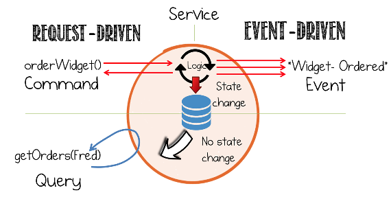
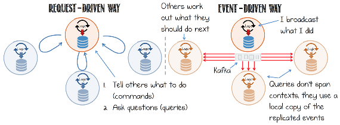
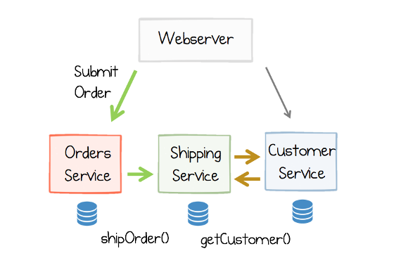
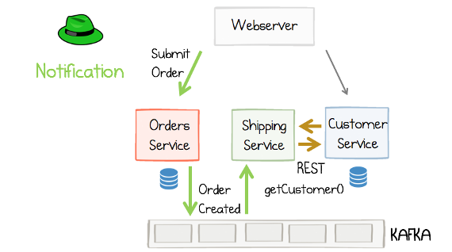
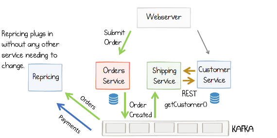
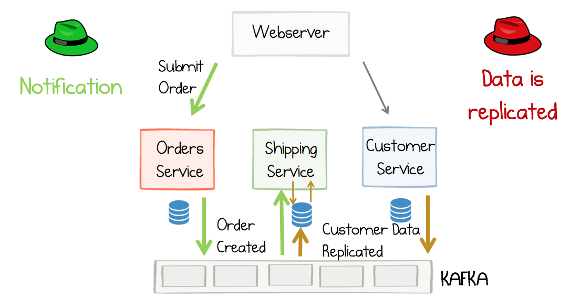
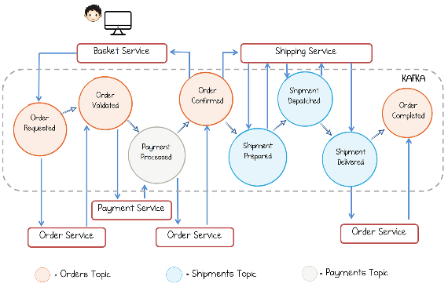
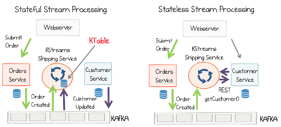
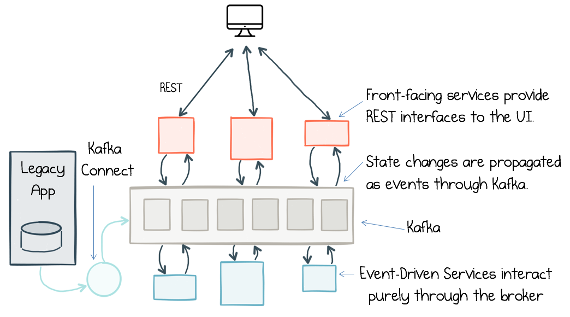
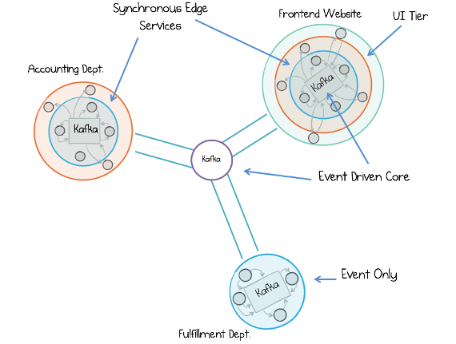

# CHAPTER 5 &emsp; Events: A Basis for Collaboration

Service-based architectures, like microservices or SOA, are commonly built with synchronous request-response protocols. This approach is very natural. It is, after all, the way we write programs: we make calls to other code modules, await a response, and continue. It also fits closely with a lot of use cases we see each day: front-facing websites where users hit buttons and expect things to happen, then return.

But when we step into a world of many independent services, things start to change. As the number of services grows gradually, the web of synchronous interactions grows with them. Previously benign availability issues start to trigger far more widespread outages. Our ops engineers often end up as reluctant detectives, playing out distributed murder mysteries as they frantically run from service to service, piecing together snippets of secondhand information. (Who said what, to whom, and when?)

This is a well-known problem, and there are a number of solutions. One is to ensure each individual service has a significantly higher SLA than your system as a whole. Google provides a protocol for doing this. An alternative is to simply break down the synchronous ties that bind services together using (a) asynchronicity and (b) a message broker as an intermediary.

Say you are working in online retail. You would probably find that synchronous interfaces like `getImage()` or `processOrder()`—calls that expect an immediate response—feel natural and familiar. But when a user clicks Buy, they actually trigger a large, complex, and asynchronous process into action. This process takes a purchase and physically ships it to the user’s door, way beyond the context of the original button click. So splitting software into asynchronous flows allows us to compartmentalize the different problems we need to solve and embrace a world that is itself inherently asynchronous.

In practice we tend to embrace this automatically. We’ve all found ourselves polling database tables for changes, or implementing some kind of scheduled cron job to churn through updates. These are simple ways to break the ties of synchronicity, but they always feel like a bit of a hack. There is a good reason for this: they probably are.

So we can condense all these issues into a single observation. The imperative programming model, where we command services to do our bidding, isn’t a great fit for estates where services are operated independently.

In this chapter we’re going to focus on the other side of the architecture coin: composing services not through chains of commands and queries, but rather through streams of events. This is an implementation pattern in its own right, and has been used in industry for many years, but it also forms a baseline for the more advanced patterns we’ll be discussing in Part III and Part V, where we blend the ideas of event-driven processing with those seen in streaming platforms.

## Commands, Events, and Queries

Before we go any further, consider that there are three distinct ways that programs can interact over a network: commands, events, and queries. If you’ve not considered the distinction between these three before, it’s well worth doing so, as it provides an important reference for interprocess communication.

The three mechanisms through which services interact can be described as follows (see Table 5-1 and Figure 5-1):

*Commands*  
Commands are actions—requests for some operation to be performed by another service, something that will change the state of the system. Commands execute synchronously and typically indicate completion, although they may also include a result.1

- Example: `processPayment()`, returning whether the payment succeeded.
- When to use: On operations that must complete synchronously, or when using orchestration or a process manager. Consider restricting the use of commands to inside a bounded context.

*Events*  
Events are both a fact and a notification. They represent something that *happened* in the real world but include no expectation of any future action. They travel in only one direction and expect no response (sometimes called “fire and forget”), but one may be “synthesized” from a subsequent event.

- Example: `OrderCreated{Widget}`, `CustomerDetailsUpdated{Customer}`
- When to use: When loose coupling is important (e.g., in multiteam systems), where the event stream is useful to more than one service, or where data must be replicated from one application to another. Events also lend themselves to concurrent execution.

*Queries*  
Queries are a request to look something up. Unlike events or commands, queries are free of side effects; they leave the state of the system unchanged.

- Example: `getOrder(ID=42) returns Order(42,…)`.
- When to use: For lightweight data retrieval across service boundaries, or heavyweight data retrieval within service boundaries.

 

*Table 5-1. Differences between commands, events, and queries*

|  | Behavior/state change | Includes a response |
|-|-|-|
| Command | Requested to happen | Maybe |
| Event | Just happended | Never |
| Query | None | Always |

The beauty of events is they wear two hats: a notification hat that triggers services into action, but also a replication hat that copies data from one service to another. But from a services perspective, events lead to less coupling than commands and queries. Loose coupling is a desirable property where interactions cross deployment boundaries, as services with fewer dependencies are easier to change.

*Figure 5-1. A visual summary of commands, events, and queries*

## Coupling and Message Brokers

The term *loose coupling* is used widely. It was originally a design heuristic for structuring programs, but when applied to network-attached services, particularly those run by different teams, it must be interpreted slightly differently. Here is a relatively recent definition from Frank Leymann:

Loose coupling reduces the number of assumptions two parties make about one another when they exchange information.

These assumptions broadly relate to a combination of data, function, and operability. As it turns out, however, this isn’t what most people mean when they use the term *loose coupling*. When people refer to a loosely coupled application, they usually mean something closer to connascence, defined as follows:2

A measure of the impact a change to one component will have on others.

This captures the intuitive notion of coupling: that if two entities are coupled, then an action applied to one will result in some action applied to the other. But an important part of this definition of connascence is the word change, which implies a temporal element. Coupling isn’t a static thing; it matters only in the very instant that we try to change our software. In fact, if we left our software alone, and never changed it, coupling wouldn’t matter at all.

## Is Loose Coupling Always Good?

There is a widely held sentiment in industry that tight coupling is bad and loose coupling is good. This is not wholly accurate. Both tight and loose coupling are actually pretty useful in different situations. We might summarize the relationship as:

Loose coupling lets components change independently of one another. Tight coupling lets components extract more value from one another.

The path to loose coupling is not to share. If you don’t share anything, then other applications can’t couple to you. Microservices, for example, are sometimes referred to as “shared nothing,”3 encouraging different teams not to share data and not to share functionality (across service boundaries), as it impedes their ability to operate independently.4

Of course, the problem with not sharing is it’s not very collaborative; you inevitably end up reinventing the wheel or forcing others to. So while it may be convenient for you, it’s probably not so good for the department or company you work in. Somewhat unsurprisingly, sensible approaches strike a balance. Most business applications *have to* share data with one another, so there is always some level of coupling. Shared functionality, be it services like DNS or payment processing, can be valuable, as can shared code libraries. So tighter coupling can of course be a good thing, but we have to be aware that it is a tradeoff. Sharing always increases the coupling on whatever we decide to share.

<table>
    <tr>
        <td>
            
        </td>
        <td>
            Sharing always increases the coupling on whatever we decide to share.
        </td>
    </tr>
</table>

As an example, in most traditional applications, you *couple tightly* to your database and your application will extract as much value as possible from the database’s ability to perform data-intensive operations. There is little downside, as the application and database will change together, and you don’t typically let other systems use your database. A different example is DNS, used widely across an organization. In this case its wide usage makes it deeply valuable, but also tightly coupled. But as it changes infrequently and has a thin interface, there is little practical downside.

So we can observe that the coupling of a single component is really a function of three factors, with an addendum:

- Interface surface area (functionality offered, breadth and quantity of data exposed)
- Number of users
- Operational stability and performance

The addendum: Frequency of change—that is, if a component doesn’t change (be it data, function, or operation), then coupling (i.e., connascence) doesn’t matter.

Messaging helps us build loosely coupled services because it moves pure data from a highly coupled place (the source) and puts it into a loosely coupled place (the subscriber). So any operations that need to be performed on that data are not done at source, but rather in each subscriber, and messaging technologies like Kafka take most of the operational stability/performance issues off the table.

On the other hand, request-driven approaches are more tightly coupled as functionality, data, and operational factors are concentrated in a single place. Later in this chapter we discuss the idea of a *bounded context*, which is a way of balancing these two: request-driven protocols used inside the bounded context, and messaging between them. We also discuss the wider consequences of coupling in some detail in Chapter 8.

### Essential Data Coupling Is Unavoidable

All significantly sized businesses have core datasets that many programs need. If you are sending a user an email, you need their address; if you’re building a sales report, you need sales figures; and so on. Data is something applications cannot do without, and there is no way to code around not having the data (while you might, for example, code around not having access to some piece of functionality). So pretty much all business systems, in larger organizations, need a base level of *essential data coupling*.

<table>
    <tr>
        <td>
            
        </td>
        <td>
            Functional couplings are optional. Core data couplings are essential.
        </td>
    </tr>
</table>

## Using Events for Notification

Most message brokers provide a publish-subscribe facility where the logic for how messages are routed is defined by the receivers rather than the senders; this process is known as *receiver-driven* routing. So the receiver retains control of their presence in the interaction, which makes the system pluggable (see Figure 5-2).

*Figure 5-2. Comparison between the request-response and event-driven approaches demonstrating how event-driven approaches provide less coupling*

Let’s look at a simple example based on a customer ordering an iPad. The user clicks Buy, and an order is sent to the orders service. Three things then happen:

1. The shipping service is notified.
2. It looks up the address to send the iPad to.
3. It starts the shipping process.
In a REST- or RPC-based approach this might look like Figure 5-3.

*Figure 5-3. A request-driven order management system*

The same flow can be built with an event-driven approach (Figure 5-4), where the orders service simply journals the event, “Order Created,” which the shipping service then reacts to.

*Figure 5-4. An event-driven version of the system described in Figure 5-3; in this configuration the events are used only as a means of notification: the orders service notifies the shipping service via Kafka*

If we look closely at Figure 5-4, the interaction between the orders service and the shipping service hasn’t changed all that much, other than that they communicate via events rather than calling each other directly. But there is an important change: the orders service has no knowledge that the shipping service exists. It just raises an event denoting that it did its job and an order was created. The shipping service now has control over whether it partakes in the interaction. This is an example of receiver-driven routing: logic for routing is located at the receiver of the events, rather than at the sender. The burden of responsibility is flipped! This reduces coupling and adds a useful level of pluggability to the system.

Pluggability becomes increasingly important as systems get more complex. Say we decide to extend our system by adding a repricing service, which updates the price of goods in real time, tweaking a product’s price based on supply and demand (Figure 5-5). In a REST- or RPC-based approach we would need to introduce a `maybeUpdatePrice()` method, which is called by both the orders service and the payment service. But in the event-driven model, repricing is just a service that plugs into the event streams for orders and payments, sending out price updates when relevant criteria are met.

*Figure 5-5. Extending the system described in Figure 5-4 by adding a repricing service to demonstrate the pluggability of the architecture*

## Using Events to Provide State Transfer

In Figure 5-5, we used events as a means of notification, but left the query for the customer’s address as a REST/RPC call.

We can also use events as a type of state transfer so that, rather than sending the query to the customer service, we would use the event stream to replicate customer data from the customer service to the shipping service, where it can be queried locally (see Figure 5-6).

*Figure 5-6. Extending the system described in Figure 5-4 to be fully event-driven; here events are used for notification (the orders service notifies the shipping service) as well as for data replication (data is replicated from the customer service to the shipping service, where it can be queried locally).*

This makes use of the other property events have—their replication hat. (Formally this is termed event-carried state transfer, which is essentially a form of data integration.) So the notification hat makes the architecture more pluggable, and the replication hat moves data from one service to another so queries can be executed locally. Replicating a dataset locally is advantageous in much the same way that caching is often advantageous, as it makes data access patterns faster.

## Which Approach to Use

We can summarize the advantages of the pure “query by event-carried state transfer” approach as follows:

*Better isolation and autonomy*  
Isolation is required for autonomy. Keeping the data needed to drive queries isolated and local means it stays under the service’s control.

*Faster data access*  
Local data is typically faster to access. This is particularly true when data from different services needs to be combined, or where the query spans geographies.

*Where the data needs to be available offline*  
In the case of a mobile device, ship, plane, train, or the like, replicating the dataset provides a mechanism for moving and resynchronizing when connected.

On the other hand, there are advantages to the REST/RPC approach:

*Simplicity*  
It’s simpler to implement, as there are fewer moving parts and no state to manage.

*Singleton*  
State lives in only one place (inevitable caching aside!), meaning a value can be changed there and all users see it immediately. This is important for use cases that require synchronicity—for example, reading a previously updated account balance (we look at how to synthesize this property with events in “Collapsing CQRS with a Blocking Read” on page 142 in Chapter 15).

*Centralized control*  
Command-and-control workflows can be used to centralize business processes in a single controlling service. This makes it easier to reason about.

Of course, as we saw earlier, we can blend the two approaches together and, depending on which hat we emphasize, we get a solution that suits a differently sized architecture. If we’re designing for a small, lightweight use case—like building an online application—we would put weight on the notification hat, as the weight of data replication might be considered an unnecessary burden. But in a larger and more complex architecture, we might place more emphasis on the replication hat so that each service has greater autonomy over the data it queries. (This is discussed in more detail in Chapter 8.) Microservice applications tend to be larger and leverage both hats. Jonas Bonér puts this quite firmly:

Communication between microservices needs to be based on asynchronous message passing (while logic inside each microservice is performed in a synchronous fashion).

Implementers should be careful to note that he directs this at a strict definition of microservices, one where services are independently deployable. Slacker interpretations, which are seen broadly in industry, may not qualify so strong an assertion.

## The Event Collaboration Pattern

To build fine-grained services using events, a pattern called Event Collaboration is often used. This allows a set of services to collaborate around a single business workflow, with each service doing its bit by listening to events, then creating new ones. So, for example, we might start by creating an order, and then different services would evolve the workflow until the purchased item makes it to the user’s door.

This might not sound too different from any other workflow, but what is special about Event Collaboration is that no single service owns the whole process; instead, each service owns a small part—some subset of state transitions—and these plug together through a chain of events. So each service does its work, then raises an event denoting what it did. If it processed a payment, it would raise a Payment Processed event. If it validated an order, it would raise Order Validated, and so on. These events trigger the next step in the chain (which could trigger that service again, or alternatively trigger another service).

In Figure 5-7 each circle represents an event. The color of the circle designates the topic it is in. A workflow evolves from Order Requested through to Order Completed. The three services (order, payment, shipping) handle the state transitions that pertain to their section of the workflow. Importantly, no service knows of the existence of any other service, and no service owns the entire workflow. For example, the payment service knows only that it must react to validated orders and create Payment Processed events, with the latter taking the workflow one step forward. So the currency of event collaboration is, unsurprisingly, events!

*Figure 5-7. An example workflow implemented with Event Collaboration*

The lack of any one point of central control means systems like these are often termed *choreographies*: each service handles some subset of state transitions, which, when put together, describe the whole business process. This can be contrasted with *orchestration*, where a single process commands and controls the whole workflow from one place—for example, via a process manager.5 A process manager is implemented with request-response.

Choreographed systems have the advantage that they are pluggable. If the payment service decides to create three new event types for the payment part of the workflow, so long as the Payment `Processed` event remains, it can do so without affecting any other service. This is useful because it means if you’re implementing a service, you can change the way you work and no other services need to know or care about it. By contrast, in an orchestrated system, where a single service dictates the workflow, all changes need to be made in the controller. Which of these approaches is best for you is quite dependent on use case, but the advantage of orchestration is that the whole workflow is written down, in code, in one place. That makes it easy to reason about the system. The downside is that the model is tightly coupled to the controller, so broadly speaking choreographed approaches better suit larger implementations (particularly those that span teams and hence change independently of one another).

<table>
    <tr>
        <td>
            
        </td>
        <td>
            The events service’s share form a journal, or “shared narrative,” describing exactly how your business evolved over time.
        </td>
    </tr>
</table>

## Relationship with Stream Processing

The notification and replication duality that events demonstrate maps cleanly to the concepts of stateless and stateful stream processing, respectively. The best way to understand this is to consider the shipping service example we discussed earlier in the chapter. If we changed the shipping service to use the Kafka Streams API, we could approach the problem in two ways (Figure 5-8):

*Stateful approach*  
Replicate the Customers table into the Kafka Streams API (denoted “KTable” in Figure 5-8). This makes use of the event-carried state transfer approach.

*Stateless approach*  
We process events and look up the appropriate customer with every order that is processed.

*Figure 5-8. Stateful stream processing is similar to using events for both notification and state transfer (left), while stateless stream processing is similar to using events for notification (right)*

So the use of event-carried state transfer, in stateful stream processing, differs in two important ways, when compared to the example we used earlier in this chapter:

- The dataset needs to be held, in its entirety, in Kafka. So if we are joining to a table of customers, all customer records must be stored in Kafka as events.
- The stream processor includes in-process, disk-resident storage to hold the table. There is no external database, and this makes the service stateful. Kafka Streams then applies a number of techniques to make managing this statefulness practical.

This topic is discussed in detail in Chapter 6.

## Mixing Request- and Event-Driven Protocols

A common approach, particularly seen in smaller web-based systems, is to mix protocols, as shown in Figure 5-9. Online services interact directly with a user, say with REST, but also journal state changes to Kafka (see “Event Sourcing, Command Sourcing, and CQRS in a Nutshell” on page 55 in Chapter 7). Offline services (for billing, fulfillment, etc.) are built purely with events.

*Figure 5-9. A very simple event-driven services example, data is imported from a legacy application via the Connect API; user-facing services provide REST APIs to the UI; state changes are journaled to Kafka as events. at the bottom, business processing is performed via Event Collaboration*

In larger implementations, services tend to cluster together, for example within a department or team. They mix protocols inside one cluster, but rely on events to communicate between clusters (see Figure 5-10).

*Figure 5-10. Clusters of services form bounded contexts within which functionality is shared. Contexts interact with one another only through events, spanning departments, geographies or clouds*

In Figure 5-10 three departments communicate with one another only through events. Inside each department (the three larger circles), service interfaces are shared more freely and there are finer-grained event-driven flows that drive collaboration. Each department contains a number of internal bounded contexts— small groups of services that share a domain model, are usually deployed together, and collaborate closely. In practice, there is often a hierarchy of sharing. At the top of this hierarchy, departments are loosely coupled: the only thing they share is events. Inside a department, there will be many applications and those applications will interact with one another with both request-response and event-based mechanisms, as in Figure 5-9. Each application may itself be composed from several services, but these will typically be more tightly coupled to one another, sharing a domain model and having synchronized release schedules.

This approach, which confines reuse within a bounded context, is an idea that comes from domain-driven design, or DDD. One of the big ideas in DDD was that broad reuse could be counterproductive, and that a better approach was to create boundaries around areas of a business domain and model them separately. So within a bounded context the domain model is shared, and everything is available to everything else, but different bounded contexts don’t share the same model, and typically interact through more restricted interfaces.

This idea was extended by microservice implementers, so a bounded context describes a set of closely related components or services that share code and are deployed together. Across bounded contexts there is less sharing (be it code, functionality, or data). In fact, as we noted earlier in this chapter, microservices are often termed “shared nothing” for this reason.6

## Summary

Businesses are a collection of people, teams, and departments performing a wide range of functions, backed by technology. Teams need to work asynchronously with respect to one another to be efficient, and many business processes are inherently asynchronous—for example, shipping a parcel from a warehouse to a user’s door. So we might start a project as a website, where the frontend makes synchronous calls to backend services, but as it grows the web of synchronous calls tightly couple services together at runtime. Event-based methods reverse this, decoupling systems in time and allowing them to evolve independently of one another.

In this chapter we noticed that events, in fact, have two separate roles: one for notification (a call for action), and the other a mechanism for state transfer (pushing data wherever it is needed). Events make the system pluggable, and for reasonably sized architectures it is sensible to blend request- and event-based protocols, but you must take care when using these two sides of the event duality: they lead to very different types of architecture. Finally, we looked at how to scale the two approaches by separating out different bounded contexts that collaborate only through events.

But with all this talk of events, we’ve talked little of replayable logs or stream processing. When we apply these patterns with Kafka, the toolset itself creates new opportunities. Retention in the broker becomes a tool we can design for, allowing us to embrace data on the outside with a central store of events that services can refer back to. So the ops engineers, whom we discussed in the opening section of this chapter, will still be playing detective, but hopefully not quite as often—and at least now the story comes with a script!

---

1 The term *command* originally came from Bertrand Meyer’s CQS (Command Query Separation) principle. A slightly different definition from Bertrand’s is used here, leaving it optional as to whether a command should return a result or not. There is a reason for this: a command is a request for something specific to happen in the future. Sometimes it is desirable to have no return value; other times, a return value is important. Martin Fowler uses the example of popping a stack, while here we use the example of processing a payment, which simply returns whether the command succeeded. By leaving the command with an optional return type, the implementer can decide if it should return a result or not, and if not CQS/CQRS may be used. This saves the need for having another name for a command that *does* return a result. Finally, a command is never an event. A command has an explicit expectation that something (a state change or side effect) will happen in the future. Events come with no such future expectation. They are simply a statement that something happened.

2 See *https://en.wikipedia.org/wiki/Connascence* and *http://wiki.cfcl.com/pub/Projects/Connascence/Resources/p147-page-jones.pdf*.

3 “Shared nothing” is also used in the database world but to mean a slightly different thing.

4 As an anecdote, I once worked with a team that would encrypt sections of the information they published, not so it was secure, but so they could control who could couple to it (by explicitly giving the other party the encryption key). I wouldn’t recommend this practice, but it makes the point that people really care about this problem.

5 See *http://www.enterpriseintegrationpatterns.com/patterns/messaging/ProcessManager.html* and *https://www.thoughtworks.com/insights/blog/scaling-microservices-event-stream*.

6 Neil Ford, Rebecca Parsons, and Pat Kua, *Building Evolutionary Architectures* (Sebastopol, CA: O’Reilly, 2017).

