# CHAPTER 7 &emsp; Event Sourcing, CQRS, and Other Stateful Patterns

<div align="justify">

In Chapter 5 we introduced the Event Collaboration pattern, where events describe an evolving business process—like processing an online purchase or booking and settling a trade—and several services collaborate to push that workflow forward.

This leads to a log of every state change the system makes, held immutably, which in turn leads to two related patterns, Command Query Response Segregation (CQRS) and Event Sourcing,1 designed to help systems scale and be less prone to corruption. This chapter explores what these concepts mean, how they can be implemented, and when they should be applied.


## Event Sourcing, Command Sourcing, and CQRS in a Nutshell

At a high level, Event Sourcing is just the observation that events (i.e., state changes) are a core element of any system. So, if they are stored, immutably, in the order they were created in, the resulting event log provides a comprehensive audit of exactly what the system did. What’s more, we can always rederive the current state of the system by rewinding the log and replaying the events in order.

CQRS is a natural progression from this. As a simple example, you might write events to Kafka (write model), read them back, and then push them into a database (read model). In this case Kafka maps the read model onto the write model asynchronously, decoupling the two in time so the two parts can be optimized independently.

Command Sourcing is essentially a variant of Event Sourcing but applied to events that come *into* a service, rather than via the events it creates.

That’s all a bit abstract, so let’s walk through the example in Figure 7-1. We’ll use one similar to the one used in the previous chapter, where a user makes an online purchase and the resulting order is validated and returned.

<div align="center">

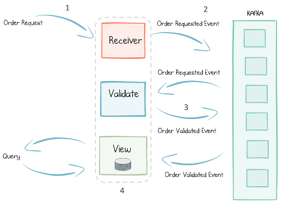

*Figure 7-1. A simple order validation workflow*

</div>

When a purchase is made (1), *Command Sourcing* dictates that the order request be immediately stored as an event in the log, before anything happens (2). That way, should anything go wrong, the service can be rewound and replayed—for example, to recover from a corruption.

Next, the order is validated, and another event is stored in the log to reflect the resulting change in state (3). In contrast to an update-in-place persistence model like CRUD (create, read, update, delete), the validated order is represented as an entirely new event, being appended to the log rather than overwriting the existing order. This is the essence of Event Sourcing.

Finally, to query orders, a database is attached to the resulting event stream, deriving an *event-sourced view* that represents the current state of orders in the system (4). So (1) and (4) provide the Command and Query sides of CQRS.

These patterns have a number of benefits, which we will examine in detail in the subsequent sections.


## Version Control for Your Data

When you store events in a log, it behaves a bit like a version control system for your data. Consider the situation illustrated in Figure 7-2. If a programmatic bug is introduced—let’s say a timestamp field was interpreted with the wrong time zone—you would get a data corruption. The corruption would make its way into the database. It would also make it into interactions the service makes with other services, making the corruption more widespread and harder to fix.

<div align="center">

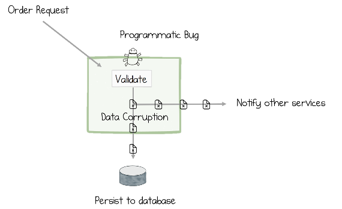

*Figure 7-2. A programmatic bug can lead to data corruption, both in the service’s own database as well as in data it exposes to other services*

</div>

Recovering from this situation is tricky for a couple of reasons. First, the original inputs to the system haven’t been recorded exactly, so we only have the corrupted version of the order. We will have to uncorrupt it manually. Second, unlike a version control system, which can travel back in time, a database is mutated in place, meaning the previous state of the system is lost forever. So there is no easy way for this service to undo the damage the corruption did.

To fix this, the programmer would need to go through a series of steps: applying a fix to the software, running a database script to fix the corrupted timestamps in the database, and finally, working out some way of resending any corrupted data previously sent to other services. At best this will involve some custom code that pulls data out of the database, fixes it up, and makes new service calls to redistribute the corrected data. But because the database is lossy—as values are overwritten—this may not be enough. (If rather than the release being fixed, it was rolled back to a previous version after some time running as the new version, the data migration process would likely be even more complex.)

<table>
    <tr>
        <td>
            
        </td>
        <td>
            A replayable log turns ephemeral messaging into messaging that remembers.
        </td>
    </tr>
</table>

Switching to an Event/Command Sourcing approach, where both inputs and state changes are recorded, might look something like Figure 7-3.

<div align="center">

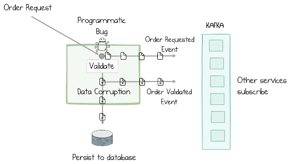

*Figure 7-3. Adding Kafka and an Event Sourcing approach to the system described in Figure 7-2 ensures that the original events are preserved before the code, and bug, execute*

</div>

As Kafka can store events for as long as we need (as discussed in “Long-Term Data Storage” on page 25 in Chapter 4), correcting the timestamp corruption is now a relatively simple affair. First the bug is fixed, then the log is rewound to before the bug was introduced, and the system is replayed from the stream of order requests. The database is automatically overwritten with corrected timestamps, and new events are published downstream, correcting the previous corrupted ones. This ability to store inputs, rewind, and replay makes the system far better at recovering from corruptions and bugs.

So Command Sourcing lets us record our inputs, which means the system can always be rewound and replayed. Event Sourcing records our state changes, which ensures we know exactly what happened during our system’s execution, and we can always regenerate our current state (in this case the contents of the database) from this log of state changes (Figure 7-4).

<div align="center">

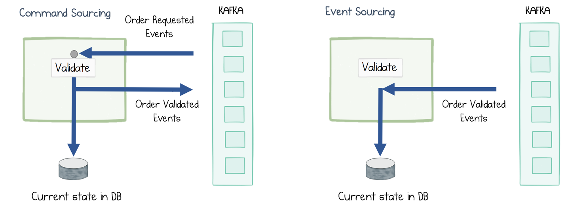

*Figure 7-4. Command Sourcing provides straight-through reprocessing from the original commands, while Event Sourcing rederives the service’s current state from just the post-processed events in the log*

</div>

Being able to store an ordered journal of state changes is useful for debugging and traceability purposes, too, answering retrospective questions like “Why did this order mysteriously get rejected?” or “Why is this balance suddenly in the red?”—questions that are harder to answer with mutable data storage.

<table>
    <tr>
        <td>
            
        </td>
        <td>
            Event Sourcing ensures every state change in a system is recorded, much like a version control system. As the saying goes, “Accountants don’t use erasers.”
        </td>
    </tr>
</table>

It is also worth mentioning that there are other well-established database patterns that provide some of these properties. Staging tables can be used to hold unvalidated inputs, triggers can be applied in many relational databases to create audit tables, and Bitemporal databases also provide an auditable data structure. These are all useful techniques, but none of them lends itself to “rewind and replay” functionality without a significant amount of effort on the programmer’s part. By contrast, with the Event Sourcing approach, there is little or no additional code to write or test. The primary execution path is used both for runtime execution as well as for recovery.


## Making Events the Source of Truth

One side effect of the previous example is that the application of Event Sourcing means the event, not the database record, is the source of truth. Making events first-class entities in this way leads to some interesting implications.

If we consider the order request example again, there are two versions of the order: one in the database and one in the notification. This leads to a couple of different issues. The first is that both the notification and database update must be made atomically. Imagine if a failure happens midway between the database being updated and the notification being sent (Figure 7-5). The best-case scenario is the creation of duplicate notifications. The worst-case scenario is that the notification might not be made at all. This issue can worsen in complex systems, as we discuss at length in Chapter 12, where we look at Kafka’s transactions feature.

<div align="center">

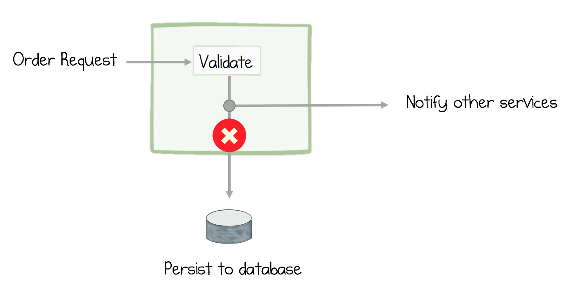

*Figure 7-5. The order request is validated and a notification is sent to other services, but the service fails before the data is persisted to the database*

</div>

The second problem is that, in practice, it’s quite easy for the data in the database and the data in the notification to diverge as code churns and features are implemented. The implication here is that, while the database may well be correct, if the notifications don’t quite match, then the data quality of the system as a whole suffers. (See “The Data Divergence Problem” on page 95 in Chapter 10.)

Event Sourcing addresses both of these problems by making the event stream the primary source of truth (Figure 7-6). Where data needs to be queried, a read model or event-sourced view is *derived* directly from the stream.

<table>
    <tr>
        <td>
            
        </td>
        <td>
            Event Sourcing ensures that the state a service communicates and the state a service saves internally are the same.
        </td>
    </tr>
</table>

This actually makes a lot of sense. In a traditional system the database is the source of truth. This is sensible from an *internal* perspective. But if you consider it from the point of view of other services, they don’t care what is stored internally; it’s the data everyone else sees that is important. So the event being the source of truth makes a lot of sense from their perspective. This leads us to CQRS.


## Command Query Responsibility Segregation

As discussed earlier, CQRS (Command Query Responsibility Segregation) separates the write path from the read path and links them with an asynchronous channel (Figure 7-6). This idea isn’t limited to application design—it comes up in a number of other fields too. Databases, for example, implement the idea of a write-ahead log. Inserts and updates are immediately journaled sequentially to disk, as soon as they arrive. This makes them durable, so the database can reply back to the user in the knowledge that the data is safe, but without having to wait for the slow process of updating the various concurrent data structures like tables, indexes, and so on.2 The point is that (a) should something go wrong, the internal state of the database can be recovered from the log, and (b) writes and reads can be optimized independently.

<div align="center">

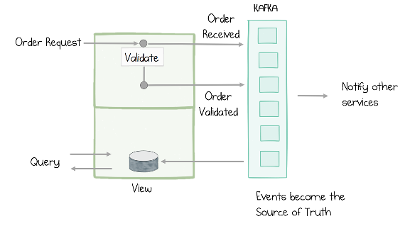

*Figure 7-6. When we make the event stream the source of truth, the notification and the database update come from the same event, which is stored immutably and durably; when we split the read and write model, the system is an implementation of the CQRS design pattern*

</div>

When we apply CQRS in our applications, we do it for very similar reasons. Inputs are journaled to Kafka, which is much faster than writing to a database. Segregating the read model and updating it asynchronously means that the expensive maintenance of update-in-place data structures, like indexes, can be batched together so they are more efficient. This means CQRS will display better overall read and write performance when compared to an equivalent, more traditional, CRUD-based system.

Of course there is no free lunch. The catch is that, because the read model is updated asynchronously, it will run slightly behind the write model in time. So if a user performs a write, then immediately performs a read, it is possible that the entry they wrote originally has not had time to propagate, so they can’t “read their own writes.” As we will see in the example in “Collapsing CQRS with a Blocking Read” on page 142 in Chapter 15, there are strategies for addressing this problem.


## Materialized Views

There is a close link between the query side of CQRS and a materialized view in a relational database. A materialized view is a table that contains the results of some predefined query, with the view being updated every time any of the underlying tables change.

Materialized views are used as a performance optimization so, instead of a query being computed when a user needs data, the query is precomputed and stored. For example, if we wanted to display how many active users there are on each page of a website, this might involve us scanning a database table of user visits, which would be relatively expensive to compute. But if we were to precompute the query, the summary of active users that results will be comparatively small and hence fast to retrieve. Thus, it is a good candidate to be precomputed.

We can create exactly the same construct with CQRS using Kafka. Writes go into Kafka on the command side (rather than updating a database table directly). We can transform the event stream in a way that suits our use case, typically using Kafka Streams or KSQL, then materialize it as a precomputed query or materialized view. As Kafka is publish-subscribe, we can have many such views, precomputed to match the various use cases we have (Figure 7-7). But unlike with materialized views in a relational database, the underlying events are decoupled from the view. This means (a) they can be scaled independently, and (b) the writing process (so whatever process records user visits) doesn’t have to wait for the view to be computed before it returns.

<div align="center">

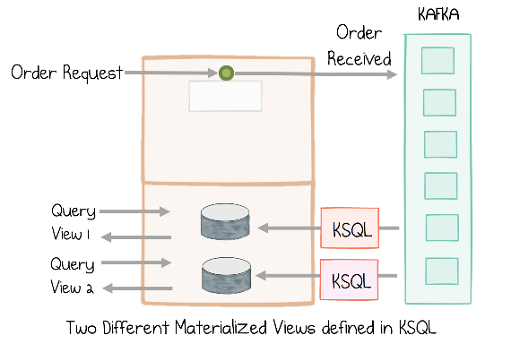

*Figure 7-7. CQRS allows multiple read models, which may be optimized for a specific use case, much like a materialized view, or may use a different storage technology*

</div>

This idea of storing data in a log and creating many derived views is taken further when we discuss “Event Streams as a Shared Source of Truth” in Chapter 9.

<table>
    <tr>
        <td>
            
        </td>
        <td>
            If an event stream is the source of truth, you can have as many different views in as many different shapes, sizes, or technologies as you may need. Each is focused on the use case at hand.
        </td>
    </tr>
</table>


## Polyglot Views

Whatever sized data problem you have, be it free-text search, analytic aggregation, fast key/value lookups, or a host of others, there is a database available today that is just right for your use case. But this also means there is no “one- size-fits-all” approach to databases, at least not anymore. A supplementary benefit of using CQRS is that a single write model can push data into many read models or materialized views. So your read model can be in any database, or even a range of different databases.

A replayable log makes it easy to bootstrap such polyglot views from the same data, each tuned to different use cases (Figure 7-7). A common example of this is to use a fast key/value store to service queries from a website, but then use a search engine like Elasticsearch or Solr to support the free-text-search use case.


## Whole Fact or Delta?

One question that arises in event-driven—particularly event-sourced—programs, is whether the events should be modeled as whole facts (a whole order, in its entirety) or as deltas that must be recombined (first a whole order message, followed by messages denoting only what changed: “amount updated to $5,” “Order cancelled,” etc.).

As an analogy, imagine you are building a version control system like SVN or Git. When a user commits a file for the first time, the system saves the whole file to disk. Subsequent commits, reflecting changes to that file, might save only the *delta*—that is, just the lines that were added, changed, or removed. Then, when the user checks out a certain version, the system opens the version-0 file and applies all subsequent deltas, in order, to derive the version the user asked for.

The alternate approach is to simply store the whole file, exactly as it was at the time it was changed, for every single commit. This will obviously take more storage, but it means that checking out a specific version from the history is a quick and easy file retrieval. However, if the user wanted to compare different versions, the system would have to use a “diff” function.

These two approaches apply equally to data we keep in the log. So to take a more business-oriented example, an order is typically a set of line items (i.e., you often order several different items in a single purchase). When implementing a system that processes purchases, you might wonder: should the order be modeled as a single order event with all the line items inside it, or should each line item be a separate event with the order being recomposed by scanning the various independent line items? In domain-driven design, an order of this latter type is termed an *aggregate* (as it is an aggregate of line items) with the wrapping entity—that is, the order—being termed an *aggregate root*.

As with many things in software design, there are a host of different opinions on which approach is best for a certain use case. There are a few rules of thumb that can help, though. The most important one is *journal the whole fact as it arrived*. So when a user creates an order, if that order turns up with all line items inside it, we’d typically record it as a single entity.

But what happens when a user cancels a single line item? The simple solution is to just journal the whole thing again, as another aggregate but cancelled. But what if for some reason the order is not available, and all we get is a single canceled line item? Then there would be the temptation to look up the original order internally (say from a database), and combine it with the cancellation to create a new Cancelled Order with all its line items embedded inside it. This typically isn’t a good idea, because (a) we’re not recording exactly what we received, and (b) having to look up the order in the database erodes the performance benefits of CQRS. The rule of thumb is record what you receive, so if only one line item arrives, record that. The process of combining can be done on read.

Conversely, breaking events up into subevents as they arrive often isn’t good practice, either, for similar reasons. So, in summary, the rule of thumb is *record exactly what you receive, immutably*.


## Implementing Event Sourcing and CQRS with Kafka

Kafka ships with two different APIs that make it easier to build and manage CQRS-styled views derived from events stored in Kafka. The Kafka Connect API and associated Connector ecosystem provides an out-of-the-box mechanism to push data into, or pull data from, a variety of databases, data sources, and data sinks. In addition, the Kafka Streams API ships with a simple embedded database, called a state store, built into the API (see “Windows, Joins, Tables, and State Stores” on page 135 in Chapter 14).

In the rest of this section we cover some useful patterns for implementing Event Sourcing and CQRS with these tools.


### Build In-Process Views with Tables and State Stores in Kafka Streams

Kafka’s Streams API provides one of the simplest mechanisms for implementing Event Sourcing and CQRS because it lets you implement a view natively, right inside the Kafka Streams API—no external database needed!

At its simplest this involves turning a stream of events in Kafka into a table that can be queried locally. For example, turning a stream of Customer events into a table of ```Customers``` that can be queried by ```CustomerId``` takes only a single line of code:

```
    KTable<CustomerId, Customer> customerTable = builder.table("customer-topic");
```

This single line of code does several things:

- It subscribes to events in the customer topic.
- It resets to the earliest offset and loads all Customer events into the Kafka Streams API. That means it loads the data from Kafka into your service. (Typically a compacted topic is used to reduce the initial/worst-case load time.)
- It pushes those events into a state store (Figure 7-8), a local, disk-resident hash table, located inside the Kafka Streams API. This results in a local, disk- resident table of Customers that can be queried by key or by range scan.

<div align="center">

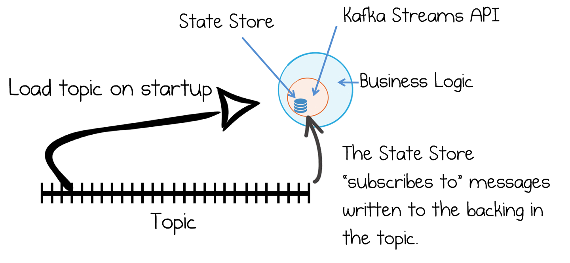

*Figure 7-8. State stores in Kafka Streams can be used to create use-case-specific views right inside the service*

</div>

In Chapter 15 we walk through a set of richer code examples that create different types of views using tables and state stores, along with discussing how this approach can be scaled.


### Writing Through a Database into a Kafka Topic with Kafka Connect

One way to get events into Kafka is to write *through* a database table into a Kafka topic. Strictly speaking, this isn’t an Event Sourcing– or CQRS-based pattern, but it’s useful nonetheless.

In Figure 7-9, the orders service writes orders to a database. The writes are converted into an event stream by Kafka’s Connect API. This triggers downstream processing, which validates the order. When the “Order Validated” event returns to the orders service, the database is updated with the final state of the order, before the call returns to the user.

<div align="center">

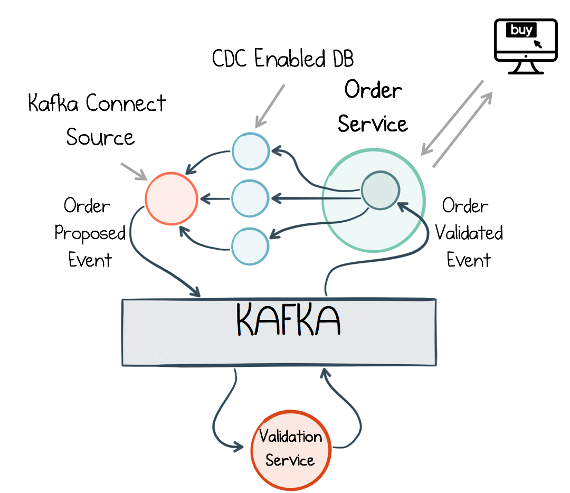

*Figure 7-9. An example of writing through a database to an event stream*

</div>

The most reliable and efficient way to achieve this is using a technique called change data capture (CDC). Most databases write every modification operation to a write-ahead log, so, should the database encounter an error, it can recover its state from there. Many also provide some mechanism for capturing modification operations that were committed. Connectors that implement CDC repurpose these, translating database operations into events that are exposed in a messaging system like Kafka. Because CDC makes use of a native “eventing” interface it is (a) very efficient, as the connector is monitoring a file or being triggered directly when changes occur, rather than issuing queries through the database’s main API, and (b) very accurate, as issuing queries through the database’s main API will often create an opportunity for operations to be missed if several arrive, for the same row, within a polling period.

In the Kafka ecosystem CDC isn’t available for every database, but the ecosystem is growing. Some popular databases with CDC support in Kafka Connect are MySQL, Postgres, MongoDB, and Cassandra. There are also proprietary CDC connectors for Oracle, IBM, SQL Server, and more. The full list of connectors is available on the Connect home page.

The advantage of this database-fronted approach is that it provides a consistency point: you write through it into Kafka, meaning you can always read your own writes.


### Writing Through a State Store to a Kafka Topic in Kafka Streams

The same pattern of writing through a database into a Kafka topic can be achieved inside Kafka Streams, where the database is replaced with a Kafka Streams state store (Figure 7-10). This comes with all the benefits of writing through a database with CDC, but has a few additional advantages:

- The database is local, making it faster to access.
- Because the state store is wrapped by Kafka Streams, it can partake in transactions, so events published by the service and writes to the state store are atomic.
- There is less configuration, as it’s a single API (no external database, and no CDC connector to configure).

We discuss this use of state stores for holding application-level state in the section “Windows, Joins, Tables, and State Stores” on page 135 in Chapter 14.

<div align="center">

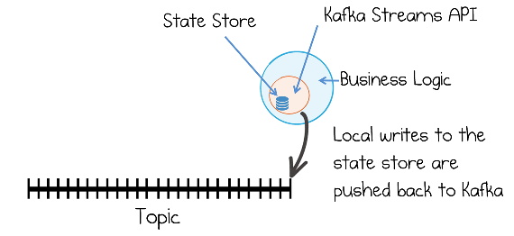

*Figure 7-10. Applying the write-through pattern with Kafka Streams and a state store*

</div>


### Unlocking Legacy Systems with CDC

In reality, most projects have some element of legacy and renewal, and while there is a place for big-bang redesigns, incremental change is typically an easier pill to swallow.

The problem with legacy is that there is usually a good reason for moving away from it: the most common being that it is hard to change. But most business operations in legacy applications will converge on their database. This means that, no matter how creepy the legacy code is, the database provides a coherent seam to latch into the existing business workflow, from where we can extract events via CDC. Once we have the event stream, we can plug in new event-driven services that allow us to evolve away from the past, incrementally (Figure 7-11).

<div align="center">

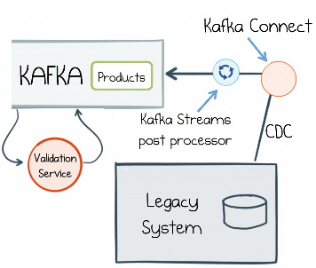

*Figure 7-11. Unlocking legacy data using Kafka’s Connect API*

</div>

So part of our legacy system might allow admins to manage and update the product catalog. We might retain this functionality by importing the dataset into Kafka from the legacy system’s database. Then that product catalog can be reused in the validation service, or any other.

An issue with attaching to legacy, or any externally sourced dataset, is that the data is not always well formed. If this is a problem, consider adding a post- processing stage. Kafka Connect’s single message transforms are useful for this type of operation (for example, adding simple adjustments or enrichments), while Kafka’s Streams API is ideal for simple to very complex manipulations and for precomputing views that other services need.


### Query a Read-Optimized View Created in a Database

Another common pattern is to use the Connect API to create a read-optimized, event-sourced view, built inside a database. Such views can be created quickly and easily in any number of different databases using the sink connectors available for Kafka Connect. As we discussed in the previous section, these are often termed *polyglot views*, and they open up the architecture to a wide range of data storage technologies.

In the example in Figure 7-12, we use Elasticsearch for its rich indexing and query capabilities, but whatever shape of problem you have, these days there is a database that fits. Another common pattern is to precompute the contents as a materialized view using Kafka Streams, KSQL, or Kafka Connect’s single message transforms feature (see “Materialized Views” on page 62 earlier in this chapter).

<div align="center">

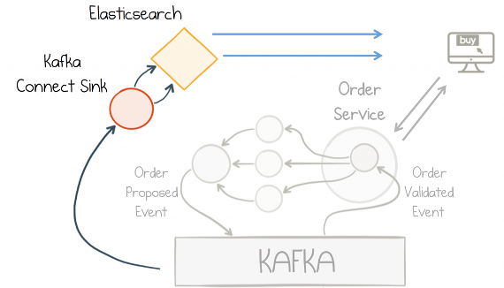

*Figure 7-12. Full-text search is added via an Elasticsearch database connected through Kafka’s Connect API*

</div>


### Memory Images/Prepopulated Caches

Finally, we should mention a pattern called MemoryImage (Figure 7-13). This is just a fancy term, coined by Martin Fowler, for caching a whole dataset into memory—where it can be queried—rather than making use of an external database.

<div align="center">

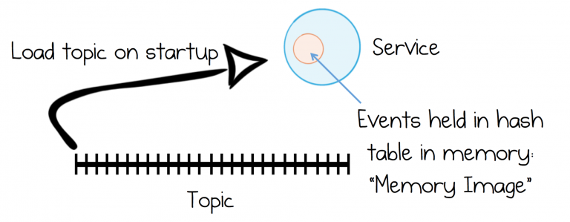

*Figure 7-13. A MemoryImage is a simple “cache” of an entire topic loaded into a service so it can be referenced locally*

</div>

MemoryImages provide a simple and efficient model for datasets that (a) fit in memory and (b) can be loaded in a reasonable amount of time. To reduce the load time issue, it’s common to keep a snapshot of the event log using a compacted topic (which represents the latest set of events, without any of the version history). The MemoryImage pattern can be hand-crafted, or it can be implemented with Kafka Streams using in-memory state stores. The pattern suits high- performance use cases that don’t need to overflow to disk.


### The Event-Sourced View

Throughout the rest of this book we will use the term *event-sourced view* (Figure 7-14) to refer to a query resource (database, memory image, etc.) created in one service from data authored by (and hence owned) by another.

<div align="center">

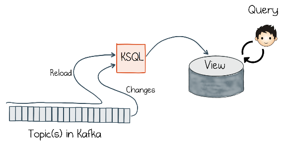

*Figure 7-14. An event-sourced view implemented with KSQL and a database; if built with Kafka Streams, the query and view both exist in the same layer*

</div>

What differentiates an event-sourced view from a typical database, cache, and the like is that, while it can represent data in any form the user requires, its data is sourced directly from the log and can be regenerated at any time.

For example, we might create a view of orders, payments, and customer information, filtering anything that doesn’t ship within the US. This would be an event- sourced view if, when we change the view definition—say to include orders that ship to Canada—we can automatically recreate the view in its entirety from the log.

An event-sourced view is equivalent to a projection in Event Sourcing parlance.


## Summary

In this chapter we looked at how an event can be more than just a mechanism for notification, or state transfer. Event Sourcing is about saving state using the exact same medium we use to communicate it, in a way that ensures that every change is recorded immutably. As we noted in the section “Version Control for Your Data” on page 57, this makes recovery from failure or corruption simpler and more efficient when compared to traditional methods of application design.

CQRS goes a step further by turning these raw events into an event-sourced view—a queryable endpoint that derives itself (and can be rederived) directly from the log. The importance of CQRS is that it scales, by optimizing read and write models independently of one another.
 
We then looked at various patterns for getting events into the log, as well as building views using Kafka Streams and Kafka’s Connect interface and our database of choice.

Ultimately, from the perspective of an architect or programmer, switching to this event-sourced approach will have a significant effect on an application’s design. Event Sourcing and CQRS make events first-class citizens. This allows systems to relate the data that lives inside a service directly to the data it shares with others. Later we’ll see how we can tie these together with Kafka’s Transactions API. We will also extend the ideas introduced in this chapter by applying them to interteam contexts, with the “Event Streaming as a Shared Source of Truth” approach discussed in Chapter 9.

---

1 See *https://martinfowler.com/eaaDev/EventSourcing.html* and *http://bit.ly/2pLKRFF*.

2 Some databases—for example, DRUID—make this separation quite concrete. Other databases block until indexes have been updated.

</div>