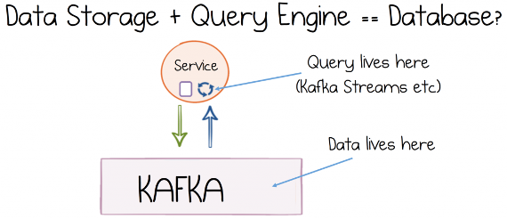
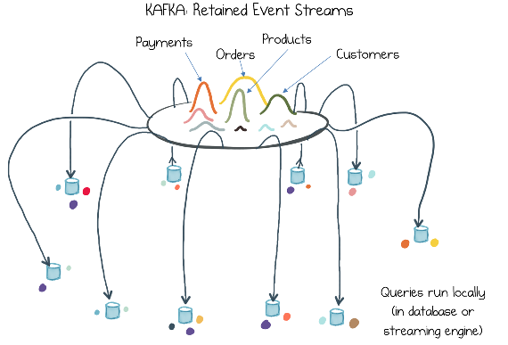

# CHAPTER 9 &emsp; Events Streams as a Shared Source of Truth

As we saw in Part II of this book, events are a useful tool for system design, providing notification, state transfer, and decoupling. For a couple of decades now, messaging systems have leveraged these properties, moving events from system to system, but only in the last few years have messaging systems started to be used as a storage layer, retaining the datasets that flow through them. This creates an interesting architectural pattern. A company’s core datasets are stored as centralized event streams, with all the decoupling effects of a message broker built in. But unlike traditional brokers, which delete messages once they have been read, historic data is stored and made available to any team that needs it. This links closely with the ideas developed in Event Sourcing (see Chapter 7) and Pat Helland’s concept of data on the outside. ThoughtWorks calls this pattern event streaming as the source of truth.

## A Database Inside Out

“Turning the database inside out” was a phrase coined by Martin Kleppmann. Essentially it is the idea that a database has a number of core components—a commit log, a query engine, indexes, and caching—and rather than conflating these concerns inside a single black-box technology like a database does, we can split them into separate parts using stream processing tools and these parts can exist in different places, joined together by the log. So Kafka plays the role of the commit log, a stream processor like Kafka Streams is used to create indexes or views, and these views behave like a form of continuously updated cache, living inside or close to your application (Figure 9-1).

*Figure 9-1. A streaming engine and a replayable log have the core components of a database*

As an example we might consider this pattern in the context of a simple GUI application that lets users browse order, payment, and customer information in a scrollable grid. Because the user can scroll the grid quickly up and down, the data would likely need to be cached locally. But in a streaming model, rather than periodically polling the database and then caching the result, we would define a view that represents the exact dataset needed in the scrollable grid, and the stream processor would take care of materializing it for us. So rather than querying data in a database, then layering caching over the top, we explicitly push data to where it is needed and process it there (i.e., it’s inside the GUI, right next to our code).

But while we call “turning the database inside out” a pattern, it would probably be more accurate to call it an analogy: a different way of explaining what stream processing is. It is a powerful one, though. One reason that it seems to resonate with people is we have a deep-seated notion that pushing business logic into a database is a bad idea. But the reverse—pushing data into your code—opens up a wealth of opportunities for blending our data and our code together. So stream processing flips the traditional approach to data and code on its head, encouraging us to bring data into the application layer—to create tables, views, and indexes exactly where we need them.

<table>
    <tr>
        <td>
            
        </td>
        <td>
            “The database inside out” is an analogy for stream processing where the same components we find in a database—a commit log, views, indexes, caches—are not confined to a single place, but instead can be made available wherever they are needed.
        </td>
    </tr>
</table>

This idea actually comes up in a number of other areas too. The Clojure community talks about deconstructing the database. There are overlaps with Event Sourcing and polyglot persistence as we discussed in Chapter 7. But the idea was originally proposed by Jay Kreps back in 2013, where he calls it “unbundling” but frames it in a slightly different context, and this turns out to be quite important:

There is an analogy here between the role a log serves for data flow inside a distributed database and the role it serves for data integration in a larger organization…if you squint a bit, you can see the whole of your organization’s systems and data flows as a single distributed database. You can view all the individual query-oriented systems (Redis, SOLR, Hive tables, and so on) as just particular indexes on your data. You can view the stream processing systems like Storm or Samza as just a very well-developed trigger and view materialization mechanism. Classical database people, I have noticed, like this view very much because it finally explains to them what on earth people are doing with all these different data systems—they are just different index types!

What is interesting about Jay’s description is he casts the analogy in the context of a whole company. The key insight is essentially the same: stream processing segregates responsibility for data storage away from the mechanism used to query it. So there might be one shared event stream, say for payments, but many specialized views, in different parts of the company (Figure 9-2). But this provides an important alternative to traditional mechanisms for data integration. More specifically:

- The log makes data available centrally as a shared source of truth but with the simplest possible contract. This keeps applications loosely coupled.
- Query functionality is not shared; it is private to each service, allowing teams to move quickly by retaining control of the datasets they use.

*Figure 9-2. A number of different applications and services, each with its own views, derived from the company’s core datasets held in Kafka; the views can be optimized for each use case*

<table>
    <tr>
        <td>
            
        </td>
        <td>
            The “database inside out” idea is important because a replayable log, combined with a set of views, is a far more malleable entity than a single shared database. The different views can be tuned to different people’s needs, but are all derived from the same source of truth: the log.
        </td>
    </tr>
</table>

As we’ll see in Chapter 10, this leads to some further optimizations where each view is optimized to target a specific use case, in much the same way that materialized views are used in relational databases to create read-optimized, use-case-focused datasets. Of course, unlike in a relational database, the view is decoupled from the underlying data and can be regenerated from the log should it need to be changed. (See “Materialized Views” on page 62 in Chapter 7.)

## Summary

This chapter introduced the analogy that stream processing can be viewed as a database turned inside out, or unbundled. In this analogy, responsibility for data storage (the log) is segregated from the mechanism used to query it (the Stream Processing API). This makes it possible to create views and embed them exactly where they are needed—in another application, in another geography, or on another platform. There are two main drivers for pushing data to code in this way:

- As a performance optimization, by making data local
- To decouple the data in an organization, but keep it close to a single shared source of truth

So at an organizational level, the pattern forms a kind of database of databases where a single repository of event data is used to feed many views, and each view can flex with the needs of that particular team.

